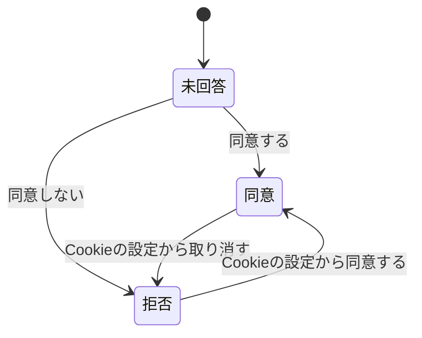

# ドメインモデル: アクセス解析（features/analytics）

アクセス解析の今の仕様の正本です。経緯は [analytics-plan.md](../plans/analytics-plan.md)、保存項目は [data-inventory.md](../data-inventory.md) の13節にあります。不変条件の番号（`ANALYTICS-INV-n`）の扱いは `docs/domain/auth.md` と同じです。

## 1. 用語

| 用語 | 英語名 | 意味 |
|---|---|---|
| 測定ID | `ANALYTICS_GA4_ID` | GA4のID（`G-` で始まる）。環境変数 `ANALYTICS_GA4_ID` |
| 同意の案内 | — | 公開ページの下に出す、同意するかを選ぶ画面 |
| 計測する画面 | `AddAnalytics` | 処理が `AddAnalytics` を呼ぶ画面。トップ、`/privacy`、お知らせ、カタログ、固定ページ |

## 2. 状態の移り変わり

- 同意の結果はブラウザの `localStorage` にだけ置く。保存できない環境では案内を出さず、計測もしない。
- 他のタブの回答は `storage` イベントで受ける。イベントの値は信用せず、今の保存値を読み直す。値が消されたときと、戻るの操作で復元されたページも同じ処理を通る。
- 取り消しは、保存に失敗しても、そのページの計測を先に止める。

## 3. 不変条件

| 番号 | 条件 | 守る場所 |
|---|---|---|
| ANALYTICS-INV-1 | 機能を登録しなければ、公開ページのHTML、CSP、JSの読み込みは変わらない | `AddAnalytics`・`SetAnalytics` |
| ANALYTICS-INV-2 | 同意するまで、Googleのスクリプトを読み込まず、Googleへ通信しない | `analytics.js` |
| ANALYTICS-INV-3 | 管理画面、ログイン、お問い合わせ、404には、部品もCSPの緩和も付かない。計測する画面だけが明示的に呼ぶ。静的書き出しの `_headers` は全パス共通なので、404にも解析用のCSPが付くが、スクリプトは読み込まない | `AddAnalytics` |
| ANALYTICS-INV-4 | 拒否の後は読み込まず、案内も再び出さない | `analytics.js` |
| ANALYTICS-INV-5 | 取り消すと以後の計測を止め、`_ga` で始まるCookieを消す。他のタブにも伝える | `analytics.js` |
| ANALYTICS-INV-6 | 機能を登録したのに測定IDが誤っていれば、起動と静的書き出しを止める | `Analytics`・`BuildRoutes` |
| ANALYTICS-INV-7 | サーバーはCookieを発行せず、同意の結果を受け取らない | `AddAnalytics` |

## 4. 守らない範囲

- 法令への適合は保証しない。外部送信規律、外国への提供、EU等の要件は運営者が確かめる。
- 同意を拒否した人と、案内を操作しない人は数えない。
- 同意の後に読み込む `gtag.js` の中身はキットの管理外で、そのページでは外部のスクリプトが動く。
- ブラウザが保存領域を消すと、案内が再び出ることがある。
- Google広告との連携は対象外で、使うならCSPの許可先を足す必要がある。
- `Referrer-Policy` は緩めないので、サイト内の遷移の参照元は取れない。
