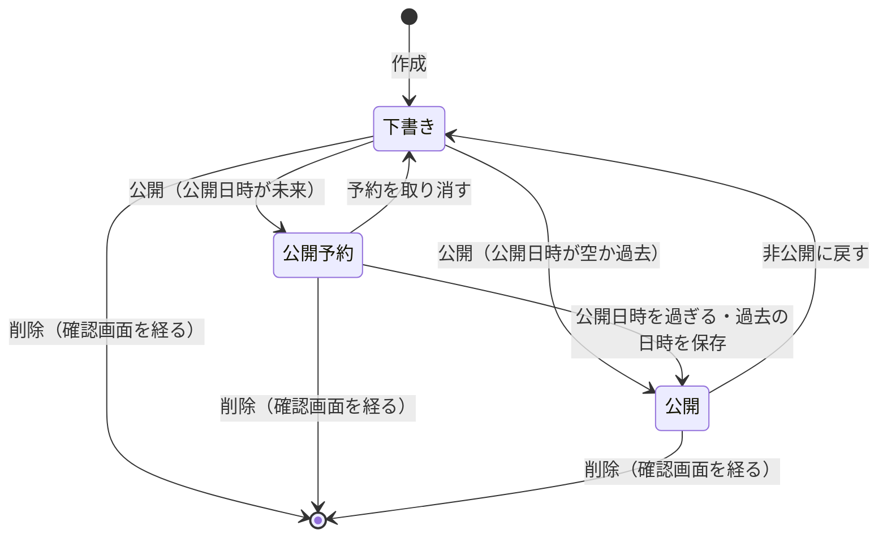

# ドメインモデル: カタログ（features/catalog）

現在の仕様の正本。変更の経緯は [catalog-plan.md](../plans/catalog-plan.md)、保存データは [data-inventory.md](../data-inventory.md) の6節。不変条件は対応するテスト関数のコメントと機械的に突き合わせる。番号は使い回さない。

## 1. 用語

| 用語 | 英語名 | 意味 |
|---|---|---|
| 項目 | `Item` | 商品・サービス・事例等の1件。タイトル・本文と公開状態を持つ |
| カテゴリ | `Classification` | 項目の単一分類。未分類も許す |
| タグ | `Classification` | 項目の複数分類。1項目20個まで |
| 公開 | `published` | 誰でも閲覧できる状態 |
| 公開予約 | `Scheduled` | 公開の状態で、公開日時（`publish_at`）がまだ来ていないもの。公開ページには出さない |

## 2. 概念と関係

カテゴリ 0..1 ← 多数の項目。項目とタグは関連表による多対多。
項目はサイト全体の共有内容で、匿名OwnerIDや認証アカウントの所有物ではない。認証アカウントは操作を許可するためだけに参照する。

## 3. 状態の移り変わり

- 公開予約は、保存の上では公開（`status = published`）で、公開日時（`publish_at`）がまだ来ていない状態。公開ページには、下書きと同じく出さない。判定は要求のたびにその時刻で行い、状態を書き換える処理は無い。
- 公開日時は、編集の画面で保存してから「公開を予約する」を押す。公開の操作は保存済みの日時に従う。
- 空欄で保存しても、今の公開日時は変えない。予約をやめるのは「予約を取り消す（下書きに戻す）」で、公開日時も消す。下書きに付いた日時も、空欄の保存では消えない。
- 予約中に過去の日時を保存すると、その保存で公開ページに出る。管理画面は完了の案内で、MCPは確認の文で伝える。
- 公開ページに出ているものを未来の日時にする保存は拒否する。先に非公開に戻す。
- お知らせと違い、非公開に戻すと公開日時を消す。お知らせの公開日時は記事の日付として表示するので残すが、カタログと固定ページの公開日時は公開を始める時刻だけを表す。

カテゴリ削除 → 関連項目を未分類にする。分類変更・関連変更は項目のupdated_atにも反映する。タグ削除 → 関連だけ削除する。どちらも項目自体は削除しない。
作成・編集だけでは公開しない。削除は確認画面を経る。

## 4. 不変条件

| 番号 | 条件 | 守る場所 |
|---|---|---|
| CATALOG-INV-1 | 公開ページ・ページ内件数・分類候補・sitemap・画像に出るのは、公開の状態で公開日時を過ぎた項目とその関連だけ（予約中は下書きと同じ）。未公開詳細は404。公開候補にない分類IDは、存在しないIDと同じ200の空一覧・同じ文言にする | `publicItem`・`Store.List`・`Store.Get`・`Store.Classifications`・`SitemapEntries` |
| CATALOG-INV-2 | タイトル・本文・分類名はプレーンテキストとしてエスケープする。詳細の本文で読む記法は行の中のリンク `[文字](URL)` だけで、許可したURLだけをリンクにする | `html/template` の自動エスケープ（`render`・`renderAdmin`）、`LinkLine`（[本文の書き方](../richtext.md) 7節） |
| CATALOG-INV-3 | 管理操作は管理者認証のPage/Formで保護し、変更はPOSTのみ | `registerAdmin`（`Page`・`Form`） |
| CATALOG-INV-4 | 項目とタグ関連は同一トランザクションで保存し、失敗時は部分保存しない | `Store.save`・`Store.write` |
| CATALOG-INV-5 | 分類削除は項目を消さず、項目削除はその関連だけを消す。孤立した関連行を残さない | `DeleteClassification`・`Store.Delete`・`migration.sql` の外部キー |
| CATALOG-INV-6 | 項目・カテゴリ・タグのIDを再利用せず、同種の正規化済み分類名は重複させない | `AUTOINCREMENT`・`UNIQUE` |
| CATALOG-INV-7 | 公開閲覧で匿名セッションを照合・発行・消去せず、Cookieを追加しない | `RegisterIsolatedRoutes` |
| CATALOG-INV-8 | 内容はCoreのGC・アカウント削除・機能無効化では削除しない | `migration.sql`（所有者の列を持たない） |
| CATALOG-INV-9 | 内容・検索語・入力値をログやエラー文言に含めない | `Item.LogValue`・`Input.LogValue`・`Filter.LogValue` |
| CATALOG-INV-10 | 一覧の通常HTMLと断片で公開判定と検索条件を共有し、JSなしでも全ての重要操作が可能 | `handleList`・`filterSQL` |
| CATALOG-INV-11 | タイトル1〜200字・本文50,000字以下・分類名1〜50字・1項目20タグ以下。タイトルと分類名は正規化し改行・制御文字を拒否。管理側の存在しない分類IDは保存しない | `normalize`・`SaveClassification` |
| CATALOG-INV-12 | 検索語200字・タグ条件20個・page上限5,000。検索の構文不正は400とし、分類の存在有無で応答を変えない | `parseFilter` |
| CATALOG-INV-14 | 項目の詳細ページの説明文（`description`・`og:description`）は、項目の本文の冒頭から作る（リンクの記法は文字にし、空白をそろえ、120文字で切る）。本文が空なら題名。一覧と絞り込みの説明文は「公開中のカタログです。」のまま | `richtext.Excerpt`・`handleShow` |
| CATALOG-INV-13 | 空欄の保存は公開日時を変えない。公開ページに出ている項目を未来の日時にする保存は、保存のトランザクションの中の今の行と時刻で判定して拒否する。非公開に戻すと公開日時を消す。予約中に過去の日時を保存すると、その保存で公開になり、そのことを利用者に伝える | `checkPublishAt`・`setPublished` |

## 5. 権限

| 操作 | システム管理者 | サイト管理者 | 未ログイン |
|---|---|---|---|
| 公開項目の閲覧 | 可 | 可 | 可 |
| 項目・カテゴリ・タグの管理 | 可 | 可 | 不可 |

業務上の承認フローや項目単位の権限は設けない。Authのアカウント管理権限は変更しない。

## 6. 他の機能との関係

- Newsとはデータ・公開条件を共有しない。共通化するのは既存の認証・レイアウト等の口まで。
- 管理者認証（`features/auth`）の `features.Admin` の口だけを使う。`make add-catalog` で管理者認証も有効になり、カタログが有効な間は `make remove-auth` できない。
- Siteが有効なら、ナビにリンクを出し（`NavLinkFeature`）、Siteのヘッダー・フッターで公開ページを描き（`LayoutConsumer`）、`sitemap.xml` に公開項目を載せる（`SitemapFeature`）。
- 画像機能が有効なら、項目に代表画像を1枚付けられる（[画像の仕様](media.md)）。公開の一覧のカードと、詳細の見出しの下に出す。

## 7. UIと読み取りの仕様

公開一覧は通常HTMLとhtmxの断片で同じ検索関数を使う。タグはID指定・重複除去後のAND、カテゴリは単一、キーワードはタイトルと本文の文字列部分一致。LIKEの特殊文字はエスケープする。20件ずつid降順で表示し、21件取得で次ページを判断する。全件数は集計しない。pageは1〜5,000、上限ページで次ページを出さない。
検索の結果を差し替えたときはフォーカスを動かさず、件数の案内を読み上げる。ページ送りでは、結果の見出しへフォーカスを移す。
公開側はCore既定のno-storeを維持し、未公開化の反映待ちを作らない。公開一覧のJSだけは、中身の版を付けたURLを長くキャッシュする（版なし・古い版は短い）。通常/断片/履歴復元の区別をVaryにも示す。htmxのlocalStorage履歴は無効、戻る・進むの履歴復元はページ全体を再取得する。

管理画面は通常のフォーム・リンクで操作する。項目の作成・編集画面のタグ選択だけ、Coreのコンボボックス部品（`combobox.js`）で強化し、その画面の応答だけscript-srcをselfにする（JSなしではチェックボックスの一覧で同じ値を送る）。公開一覧の検索とページ送りだけに固定版htmxと自前JSを使い、その全ページ応答だけscript-srcをselfにする。詳細・他の管理画面・エラー応答は既定のnone（認証のWebAuthn画面はAuthの例外）。ただし項目の作成・編集のフォームを描き直す応答（入力エラーの400、競合の503）は、タグ選択の部品が要るのでselfのままにする。Alpine.jsは比較試作で評価し、採用しなかった。
書き込みの競合（SQLiteのbusy）は503と `Retry-After: 1` で返し、保存フォームでは入力を残す。項目の保存では新しいタグ名も受け付け、同名のタグがあればそれを使う。1項目20タグの上限は、重複を除く前の、既存のID数と新しい名前の数の合計に掛かる。`sitemap.xml` にはIDの大きい順に49,000件まで載せる。

項目の同時編集は後の保存が優先。変更履歴や競合検出、全文検索エンジンは持たない。長文全体のLIKE検索には走査コストがある。

## 8. 守らない範囲

- 本文の中の画像、価格・在庫・注文、公開の終了日時、JSON API、静的書き出し。
- 予約公開の時刻ちょうどの反映。判定は要求の時刻で、`sitemap.xml` の公開キャッシュ（60秒）の間は前の内容が見えることがある。一度公開した画像は、非公開に戻してもCDNとブラウザに最長1日残りうる。
- 作者・操作の記録、変更履歴、同時編集の競合検出、項目ごとの権限・承認の流れ。
- 全文検索エンジン。長文全体のLIKE検索の走査コスト。
- 検索条件は共有可能なURLに含まれ、ブラウザ履歴等には残り得る（アプリでは検索履歴を保存しない）。
