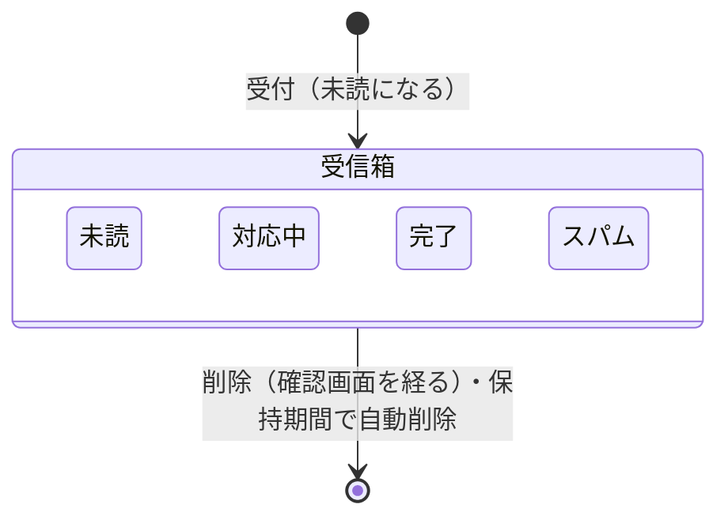

# ドメインモデル: お問い合わせ（features/contact）

現在の仕様の正本。変更の経緯は [contact-plan.md](../plans/contact-plan.md)、保存データは [data-inventory.md](../data-inventory.md) の7節。不変条件は対応するテスト関数のコメントと機械的に突き合わせる。番号は使い回さない。

## 1. 用語

| 用語 | 英語名 | 意味 |
|---|---|---|
| お問い合わせ | `Message` | 公開のフォーム（`/contact`）から送られた1件。内容（必須）・お名前（任意）・返信先（任意）を持つ |
| 受信箱 | — | 管理画面の `/admin/contact`（既定は未読と対応中）と `/admin/contact/all`（全件）。システム管理者だけが見られる |
| 種別 | `Kind` | 任意の選択式の1項目（既定は無効）。サイトが `CONTACT_KIND_*` で見出し・選択肢・必須を決める。保存するのは選択肢の識別子 |
| メモ | `Note` | 運営者が対応の引き継ぎに書く文章。1件に1つで、送った人の情報を含みうる |
| フォームの値（トークン） | `tokens` | `GET /contact` で発行する、発行時刻と使い捨ての乱数にHMAC-SHA256の署名をした値。秘密鍵はメモリにだけあり、再起動で作り直す |
| 受け付けたふり | `fake` | スパムと判定した送信を保存せず、成功と同じ完了の画面へ移すこと。人が誤って判定される余地のほぼ無い、見えない入力欄と3秒未満の送信だけに使う |

## 2. 概念と関係

お問い合わせはサイト全体のもので、匿名OwnerIDやシステム管理者アカウントの所有物ではない。

## 3. 状態の移り変わり

未読・対応中・完了・スパムは、どの状態からでも互いに変えられる。
状態の変更は管理画面のボタン（POST）で行い、開いただけでは変えない。

削除の時期:

| 状態 | 自動で削除する時期 |
|---|---|
| 未読・完了・スパム | 受付から保持期間（既定90日） |
| 対応中 | 最後の更新から保持期間。ただし受付から上限（既定365日） |

更新として数えるのは、対応中のもののメモの保存と、対応中への変更だけ。受付から保持期間を過ぎた対応中のものを別の状態へ変えると、次の削除の処理（起動時と1時間ごと）で消えるため、詳細の画面に注意を出す。

## 4. 不変条件

| 番号 | 条件 | 守る場所 |
|---|---|---|
| CONTACT-INV-1 | 公開のフォームはCookieを発行・照合せず、IPアドレス・User-Agentを保存しない。応答は `no-store` | `RegisterIsolatedRoutes`・`handleForm`・`migration.sql` |
| CONTACT-INV-3 | 受信箱はシステム管理者だけが見られ、操作できる（サイト管理者・未ログインは拒否） | `registerAdmin`（`AdminPage`・`AdminForm`） |
| CONTACT-INV-4 | 署名が合わない・期限切れ・使用済みのフォームの値では保存しない。使用済みの記録は保存に成功したときだけ残る | `tokens.check`・`tokens.claim`・`tokens.release` |
| CONTACT-INV-5 | 全体の受付上限（1時間・1日・未読）は保存した件数で数え、超えたら保存しない。判定と保存は1つのトランザクション | `Store.Save` |
| CONTACT-INV-6 | ログに入力の中身（内容・お名前・返信先・メモ）を出さない | `Message.LogValue`・`Input.LogValue` |
| CONTACT-INV-7 | 管理画面のGETは状態・メモ・最終更新を変えない | `handleList`・`handleListAll`・`handleShow` |
| CONTACT-INV-8 | 人の誤りでありうる判定（署名・期限・使用済み・URLの数・上限）は、黙って捨てず、理由と入力を返す。入力の誤りで出し直すときは、元のフォームの値を使う | `handleSubmit` |
| CONTACT-INV-9 | 送信の前に、フォームの画面で、利用目的・保持期間・プライバシーポリシーへのリンクと、特に配慮が必要な情報を書かないことを示す | `renderForm`・`contact.html` |
| CONTACT-INV-10 | `Purge` は上の表の時期で削除し、どの状態も受付から上限を超えて残らない。画面に出す削除の時期（`Retention.DeleteAt`）は `Purge` と同じ境界で判定する | `Store.Purge`・`Retention.DeleteAt` |
| CONTACT-INV-11 | 最終更新が進むのは、対応中のもののメモの保存と、対応中への変更だけ。読むだけ、対応中以外のメモの保存、同じ状態の再設定では延びない | `SetNote`・`SetStatus` |
| CONTACT-INV-12 | 旧形式の表の移行は1つのトランザクションで行い、削除の時期を延ばさず、`id` の採番を巻き戻さない。失敗したら元のままで起動を止める | `migrate` |
| CONTACT-INV-13 | 本文・お名前・返信先は、管理画面でも文字として表示する。URLやメールアドレスを自動でリンクにしない（送った人が書いた値でリンクを作らない） | `admin_message.html` |
| CONTACT-INV-14 | 種別は、無効ならフォーム・受信箱・プライバシーポリシーに出さず、送られても読まずに空で保存する。有効なら、設定した選択肢の識別子か（任意のときの）空だけを保存し、選択肢に無い値と必須の未選択は保存せずに400で入力を返す。保存するのは識別子で、表示名は表示のたびに今の設定から引く | `loadKindConfig`・`checkKind`・`kindChoices`・`PrivacyNotices`・`renderList` |
| CONTACT-INV-15 | 種別の列は、表を作り直さずに空文字を既定にして足す。前の版の実行ファイルに戻しても、保存・読み出し・起動が動き、その間の受付は種別が空になる | `addKindColumn` |

（CONTACT-INV-2 は「状態に関係なく受付から保持期間で削除」の条件で、対応中の延長に置き換えて廃止した。番号は使い回さない。）

受信箱の一覧には、削除まで7日以内のものに「あと◯日」を出す。

受付の値: フォームの値の期限は発行から1時間。全体の受付上限の既定は、直近1時間20件、直近24時間100件、未読500件で、暦の区切りではなく直近の時間で数える。超えたら503と `Retry-After: 3600` で入力を返す。保持期間は1〜365日、対応中の上限は保持期間以上・365日以下で設定する。同じ値にすると延長は効かない。メモは2,000文字まで。

## 5. 権限

| 操作 | システム管理者 | サイト管理者 | 未ログイン |
|---|---|---|---|
| 送信（公開のフォーム） | 可 | 可 | 可 |
| 受信箱の閲覧・状態の変更・メモの保存・削除 | 可 | 不可 | 不可 |

## 6. 他の機能との関係

- 管理者認証（`features/auth`）の `features.Admin` の口だけを使い、受信箱は `AdminPage`・`AdminForm` で守る。`make add-contact` で管理者認証も有効になり、お問い合わせが有効な間は `make remove-auth` できない。
- Siteが有効なら、LPのお問い合わせのボタンを `/contact` に向け（`ContactLinkFeature`）、Siteのヘッダー・フッターでフォームを描く（`LayoutConsumer`）。`CONTACT_FORM_URL`（外部のフォーム）と同時には有効にできない（起動を止める）。
- プライバシーポリシーの画面に、保存する項目と保持期間を載せる（`PrivacyFeature`）。
- 保持期間を過ぎたものは `PurgeFeature` の口で消す。お知らせ・カタログとはデータを共有しない。

## 7. 守らない範囲

- メールの送信（受信の通知・自動返信）、返信の機能、添付ファイル、種別ごとの担当への振り分け、種別ごとの件数の集計。種別は1つだけで、複数選択はできない。
- 担当者の割り当て、やり取りの履歴、顧客ごとのまとめ。メモは1件に1つで、書いた人と日時は記録しない。2人のシステム管理者が同時に書くと、後の保存が勝つ。
- 外部のCAPTCHA、JavaScriptでの判定、IPアドレスごとの上限（連打は前段のレート制限に任せる）。
- 人が手で書く宣伝と、フォームを開いてから3秒以上待って送るボット（スパムの印と、まとめての削除で後始末する）。
- 攻撃されている間の普通の人の送信。全体の受付上限に達すると、誰も送れなくなる。
- `Sec-Fetch-Site` を送らない古いブラウザからの送信、返信先に書かれた連絡先の真偽。
- 複数のサーバーで動かす構成（フォームの値の秘密鍵と使用済みの記録はメモリにだけある）。
- バックアップ・WALに残る複製の削除（保持期間は運営者が決め、プライバシーポリシーに合わせて書く）。
- 残るリスクの詳細は [contact-plan.md](../plans/contact-plan.md) の10節。
