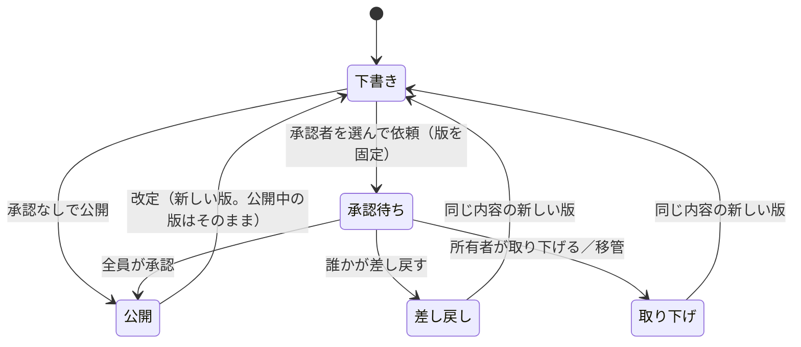

# ドメインモデル: 社内文書（features/documents）

社内文書の今の仕様の正本です。変更の経緯は [documents-plan.md](../plans/documents-plan.md)、保存データは [data-inventory.md](../data-inventory.md) の11節、ロールとログインは [auth.md](auth.md) にあります。不変条件の番号（`DOC-INV-n`）の扱いは `docs/domain/auth.md` と同じです。

## 1. 用語

| 用語 | 意味 |
|---|---|
| 文書 | 回覧や規定などの1件。所有者と共有の範囲を持つ。タイトルと本文は版が持つ |
| 所有者 | 文書を編集できる唯一のアカウント。最初は作成者 |
| 版 | 文書の内容の1回分。下書きだけ書き換えられる |
| 今の版 | 共有先に見せる、公開した最新の版 |
| 共有の範囲 | 自分だけ（`private`）、全員（`everyone`）、指定した人（`selected`）。既定は自分だけ |
| 承認者 | 所有者が版ごとに選ぶ、所有者以外の有効なアカウント |
| 既読 | 共有先が今の版を開いたことの記録。版ごとに取り直す |
| フォルダ | 全アカウント共通の1階層の棚。権限を持たない |
| 移管 | 停止中か削除済みのアカウントの文書を、別の人へ移すこと |

## 2. 概念と関係

```
文書 1 ─ n 版 1 ─ n 承認者
             1 ─ n 既読
文書 1 ─ n 共有先
文書 n ─ 0..1 フォルダ
```

- 全ロールが文書を作れる。ロールは文書の権限を変えない。システム管理者への例外は無い。
- アカウントIDは認証の表と外部キーでつながない。一覧に無いIDは「削除済みのアカウント」と表示する。
- `features.AccountDirectory` で呼び名と状態を読む。呼び名を持たない `federatedauth` とは組み合わせられず、起動を止める。

## 3. 状態の移り変わり



- 下書きと承認待ちは、合わせて文書ごとに1つまで。
- 一度でも承認を依頼した文書は、承認を経ないと公開できない。差し戻しや取り下げの後も同じ。
- 承認は全員そろって成立する。順番は無い。1人でも差し戻すと、残りの人は判断できない。
- 承認者が停止して進まないときは、所有者が取り下げて選び直す。
- 移管では承認待ちだけを閉じる。承認済みの版の記録は残るので、新しい所有者が過去に承認した版を持つことがある。
- 共有先の設定の画面には有効なアカウントだけを出す。停止中の共有先は、所有者が画面を保存し直すと外れ、再開しても戻らない。

## 4. 不変条件

| 番号 | 条件 | 守る場所 |
|---|---|---|
| DOC-INV-1 | 全ての画面にログインが要る。ログインしていない要求には内容も有無も出さない。アカウントの一覧が無い構成では起動を止める | `RegisterIsolatedRoutes`・`BuildRoutes` |
| DOC-INV-2 | 読む権限の無い文書は、一覧、検索、閲覧、版、承認の送信のどこにも出ず、404になる。判定は版ごとに行い、共有先でない承認者に公開中の別の版を見せない。システム管理者も同じ | `readsCurrent`・`Current`・`VersionFor`・`checkApprover` |
| DOC-INV-3 | 編集、共有の変更、依頼、取り下げ、削除、既読と共有先の閲覧は所有者だけができる | `owned`・`Delete` |
| DOC-INV-4 | 共有先に見えるのは今の版だけで、下書きと依頼中の版は見えない | `readsCurrent`・`Revise` |
| DOC-INV-5 | 下書き以外の版のタイトルと本文は変わらない | `document_versions_frozen`・`SaveDraft` |
| DOC-INV-6 | 承認を依頼した文書は、選んだ全員の承認でだけ公開される。依頼の後に承認なしで公開する道は無い | `Publish`・`Approve`・`recordDecision` |
| DOC-INV-7 | 所有者は自分の依頼の承認者になれない。移管では承認待ちを取り下げる | `RequestApproval`・`TransferOwner` |
| DOC-INV-8 | 既読は版ごとに1人1行で、最初の日時だけを残す。所有者、HEAD、先読みでは記録しない。記録の失敗で本文の表示を止めない | `RecordRead`・`prefetch` |
| DOC-INV-9 | 移管の対象は停止中か削除済みの所有者の文書だけ。画面には件数だけを出し、タイトルも見せない。操作者本人へは移せず、記録を残す。判定は書き込みの権利を得てから行う | `TransferOwner`・`OwnerCounts` |
| DOC-INV-10 | タイトル、本文、差し戻しの理由、検索語、フォルダの名前をログに出さない | `failed`・カナリアの検証 |
| DOC-INV-11 | アカウントの停止と削除で文書は消えない | `documents` を認証の表に結びつけない |
| DOC-INV-12 | 変更はPOSTで行う。例外は、開いたときの既読の記録だけ | `RegisterIsolatedRoutes`・`handleShow` |

## 5. 権限

| 操作 | 所有者 | 共有先 | 承認者 | それ以外 |
|---|---|---|---|---|
| 今の版を読む | ○ | ○ | × | × |
| 下書きと古い版を読む | ○ | × | × | × |
| 依頼された版を読む | ○ | × | ○（承認待ちの間と、判断の後） | × |
| 編集、共有、依頼、取り下げ、削除 | ○ | × | × | × |
| 既読と共有先を見る | ○ | × | × | × |
| 承認、差し戻し | × | × | ○ | × |

フォルダは誰でも作れて、名前は全員に見える。変更と削除は作った人かシステム管理者。文書が入っていれば削除できない。移管はシステム管理者だけ。

## 6. 守らない範囲

- 「システム管理者にも見せない」は画面の範囲の守りである。DB、バックアップ、サーバーを直接読める人の閲覧は止められない。
- 登録URLの再発行や鍵のリセットで対象になりすます操作、対象を停止して別のアカウントへ移管し、そのアカウントで読む操作は防げない。移管の記録は残る。
- 承認は社内の確認の記録で、法的な電子署名や改ざんの証明ではない。DBを書き換えられる人の変更は防げない。
- 添付、同時編集、グループ、外部への共有リンク、通知、MCPは扱わない。
