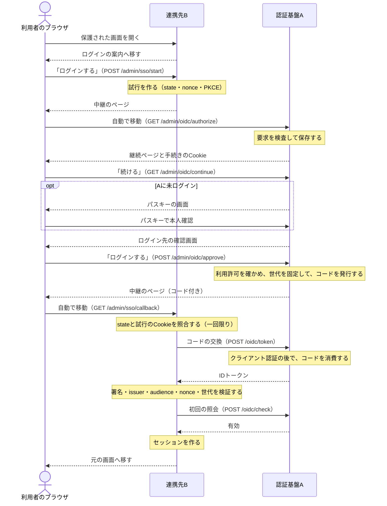
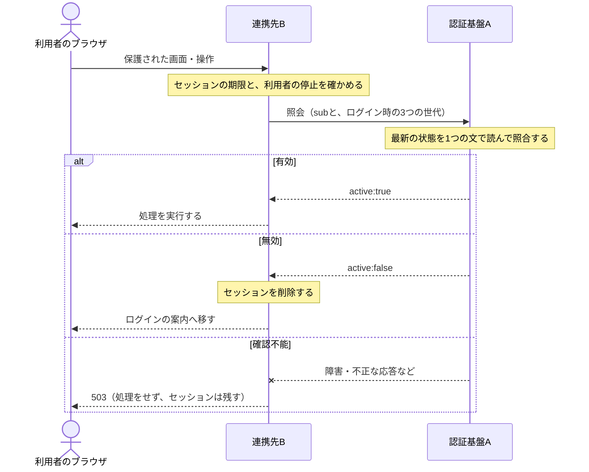
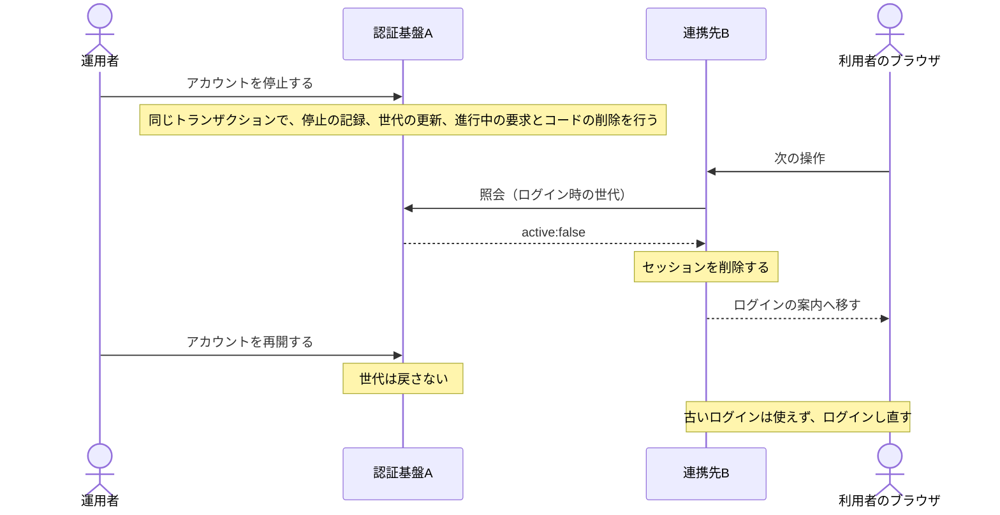

# ドメインモデル: 共通認証（features/auth/oidcop・features/federatedauth）

自社の複数のシステムで、アカウントとログインを共通にする仕組みの今の仕様の正本です。提供側の不変条件は [管理者認証の仕様](auth.md) の AUTH-INV-17・AUTH-INV-18 にあります。設計の経緯は `docs/plans/federated-auth-detail-plan.md`、保存する列は `docs/data-inventory.md` の4節と9節にあります。

## 1. 用語

| 用語 | 意味 |
|---|---|
| 認証基盤 | アカウントとパスキーを持ち、本人を確認するシステム（`features/auth/oidcop`） |
| 連携先 | 認証基盤でログインするシステム（`features/federatedauth`、または同じ契約を実装した他のシステム） |
| 世代 | `account_epoch`・`client_epoch`・`grant_epoch`。ログイン時に固定する |
| 照会 | 連携先が保護された要求のたびに、固定した世代が今も有効かを認証基盤に問うこと（`POST /oidc/check`） |
| 確認不能 | 照会の結果が、正しい形式の有効・無効のどちらでもないこと |

## 2. ログインの流れ

- 中継のページは、`Refresh` ヘッダーと通常のリンクで移動する。CSPの `form-action 'self'` はフォーム送信の後の別サイトへの転送を止めるため、303は使わない。
- 別サイトからの到着には `SameSite=Strict` のCookieが付かないため、`/admin/oidc/authorize` ではログイン状態を判定しない。利用者が「続ける」を押すと、同じサイトの操作としてCookieが付く。
- 交換と照会はサーバー間の通信で、ブラウザを通らない。
- 中止したとき、利用許可が無いときは、コードの代わりに `error=access_denied` を付けて連携先へ戻す。

## 3. 照会の結果と連携先の動作

| 認証基盤の応答 | 連携先の動作 |
|---|---|
| 200、正しい形式、`active:true`、識別と世代が一致 | 連携先の停止・ロール・期限も確かめて実行 |
| 200で、本文が `active:false` の1項目だけ | セッションを削除し、ログインの案内へ移す。POSTは再送しない |
| 200で `active:true` だが識別や世代が不一致 | 確認不能 |
| 2xxの他・4xx・5xx・タイムアウト・TLSの失敗・Content-Typeの不一致・不正な本文（空のオブジェクト、`active` の欠落やnull、`active:false` に他の項目が付くものを含む） | 確認不能 |

確認不能は503で、セッションを残し、業務の処理をしない。接続の失敗と5xxの後の5秒は問い合わせず、同時照会は32件までで待ち行列を作らない。

### 停止の反映

再開しても世代は戻らないため、古いログインは一致せず、復活しない。

## 4. 不変条件

| 番号 | 条件 | 守る場所 |
|---|---|---|
| FEDAUTH-INV-1 | 保護された要求は、毎回、認証基盤に照会して有効と確認できたときだけ実行する。肯定の結果を要求をまたいでキャッシュしない。正しい形式の無効の応答を受けたらセッションを削除する。世代はログイン時の値を使い、照会の結果で更新しない | `authorize`・`upstream.check` |
| FEDAUTH-INV-2 | 確認不能のときは503で業務の処理をせず、セッションを残す。設定の誤りや障害で全員のログインを消さない | `upstream.check`・`authorize` |
| FEDAUTH-INV-3 | ログインは、試行のCookieとstateが合うときだけ、一回限りで完了する。ログイン中のセッションは、開始でもコールバックでも置き換えない。別のブラウザにコールバックを踏ませても、ログインさせない。開始は同一オリジンのPOSTだけで、戻り先は管理画面の相対パスに限る | `attempts`・`handleStart`・`handleCallback`・`validNext` |
| FEDAUTH-INV-4 | 権限は連携先のロールで決め、認証基盤のロールをコピーしない。初回はサイト管理者で、システム管理者はコマンドで指定する。セッションは無操作2時間、または本人確認から12時間で失効する | `sessionStore` |
| FEDAUTH-INV-5 | ログアウトは認証基盤に照会せず、このシステムのセッションだけを消す。認証基盤の障害中でもログアウトできる | `handleLogout` |
| FEDAUTH-INV-6 | 認証基盤が公開するのは、下の「連携先との契約」に列挙した経路だけ。UserInfo等の未実装の機能は広告も受付もしない。CORSを許可しない。アクセストークンは保存せず、受け付ける経路も持たない | `RegisterIsolatedRoutes`・`discovery` |
| FEDAUTH-INV-7 | 連携先の通信は、設定から作った3つのURLと完全一致するHTTPSにだけ接続し、転送を追わない。期限（交換5秒、鍵と照会2秒）と本文の上限（交換32KiB、鍵64KiB、照会8KiB）を守り、秘密値はBasic認証でだけ送る | `federation.Client`・`newUpstream` |
| FEDAUTH-INV-8 | IDトークンはES256だけを受け付け、issuer・audience（1件）・azp・nonce・有効期限・発行時刻・`auth_time`・世代の形式を確かめる。`at_hash` があれば照合する。時刻のずれの許容は2分、IDトークンの寿命は5分 | `upstream.exchange`・`IDTokenLifetime` |
| FEDAUTH-INV-9 | コード・state・nonce・PKCEの値・秘密値・識別子をログに出さない | 各ハンドラのログ呼び出し |

### 連携先との契約

キット以外のシステムをつなぐときは、OIDCに加えて、次の照会を実装する。

| 経路 | 用途 | 守り |
|---|---|---|
| `GET /.well-known/openid-configuration` | 実装している項目だけの広告 | 無し |
| `GET /oidc/keys` | 署名の公開鍵 | 無し |
| `GET /admin/oidc/authorize` | 認可要求 | S256のPKCEが必須。下の制約を満たさなければ400 |
| `POST /oidc/token` | コードの交換 | Basic認証 |
| `POST /oidc/check` | 要求ごとの照会 | Basic認証 |

- 認可要求は、`scope` は `openid` だけ、`state`・`nonce` は16〜256字。`prompt`・`max_age` 等の未対応の項目は、無視せず拒否する。
- IDトークンは、claim `mwk_auth` に `account_epoch`・`client_epoch`・`grant_epoch` を持つ。世代は正の64ビット整数の10進文字列で、先頭のゼロと符号を持たない。
- 照会の本文はJSONで、`sub` と3つの世代（4KiBまで）。重複したキーと未知の項目は400。資格情報が違えば401、認証基盤の障害は503。
- 有効なら `active:true`、`iss`、`sub`、`client_id`、`mwk_auth` を返す。無効なら `active:false` だけを返し、理由は区別しない。

### 流量の上限

- 連携先のログインの試行は1024件までで、満杯なら最古を捨てる。開始は毎秒2件・バースト16件までで、超えたら429。10秒以内の再送は、同じ認可要求へ進める。
- 認証基盤の未完了の認可要求は1024件まで。受付は毎秒2件・バースト16件までで、超えたら429。

### 利用者と資格情報の運用

- 連携先の利用者の削除は、拒否ではない。再びログインすると、新しいIDのサイト管理者として作り直す。拒み続けるなら停止する（`-disable`）。停止はセッションを消し、再ログインも拒む。
- 連携先のロールの変更は既存のセッションを残し、次の要求から効く。
- 秘密値の通常の更新では、旧値を24時間併用する。続けて更新すると、それより前の旧値は消える。
- 漏洩の指定（`-rotate -compromised`）は、旧値と既存のログインを直ちに失効させる。署名鍵の漏洩やバックアップからの復元の後は、`oidc-revoke-all` で全連携先のログインを失効させる。

## 5. 守らない範囲

- 公開クライアント・SPA・モバイル、APIキー認証、refresh token、動的な連携先の登録、第三者への開放。
- 照会の後に始まった処理の巻き戻しと、開いている画面の自動の遷移。停止の反映は次の要求からで、照会済みの処理は取り消さない。
- 認証基盤の障害中の、連携先への緊急のログイン。連携先のコマンドも、照会を迂回するログインを作らない。
- 複数のインスタンスでのログイン試行の共有（試行はメモリにある）。
- 同じ登録可能ドメインの別ホストが侵害され、未ログインのブラウザに試行のCookieを植えられた場合のログインCSRF。`__Host-` 接頭辞は `Path=/` が要り、Cookieが公開ページにも送られるため採らない。ログイン中のセッションは置き換えない。
- 認可要求の受付の上限による妨害。上限は要求の検査より前に効く全体で共通の枠なので、第三者が大量に送ると、全員のログインの開始が一時的に止まる。前段のレート制限に任せる。
- 連携先どうしの相関の防止。識別子は連携先の間で共通（pairwiseにしていない）。
- バックグラウンドの処理と長時間の接続の、途中での停止の反映。
