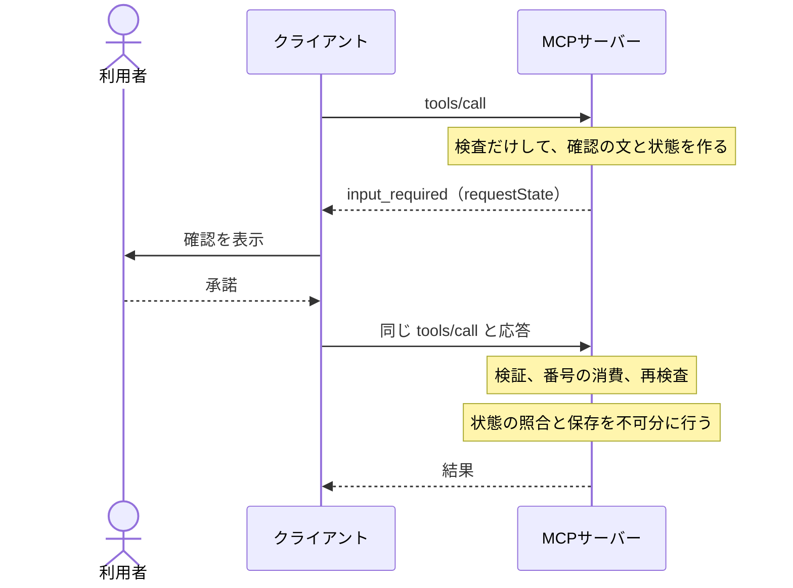

# ドメインモデル: MCP（features/mcp）

AIエージェントがMCPで機能を操作する仕組みの今の仕様の正本です。認可の不変条件は [管理者認証の仕様](auth.md) の AUTH-INV-22〜24 にあります。設計の経緯は [mcp-plan.md](../plans/mcp-plan.md)、保存データは [data-inventory.md](../data-inventory.md) の4節と10節にあります。

## 用語と関係

- ツール: 機能が `features.MCPFeature` で提供する操作。読み取りと書き込みがある。
- 確認: 書き込みの前に、クライアントが利用者に内容を見せて答えを得ること（MCPの `elicitation`）。サーバーに承認待ちの状態は無い。
- 機能の設定: 機能ごとのMCPの有効・無効。行が無ければ無効。
- 対象の状態: 確認の時点の保存内容のハッシュ。公開状態・公開日時・スラッグ・ナビの順・分類を含む。

## 書き込みの流れ

## 不変条件

| 番号 | 条件 | 実装・検証 |
|---|---|---|
| MCP-INV-1 | 種類を省いたツールは書き込みとして扱う。読み取りは `Read` だけ、書き込みは `Prepare` と `Apply` だけを持ち、未知の種類や混在は起動を止める | `validTool` |
| MCP-INV-2 | 書き込みは、検証済みの確認の `accept` が無ければ実行しない。確認に対応しないクライアント、却下、取り消しでは何も変えない | `write`・`ask` |
| MCP-INV-3 | 確認はアカウント、クライアント、認可の世代、ツール、引数、対象の状態、機能の設定の世代に結びつき、10分で切れ、一度だけ使える。結果を見る前に消費するので、却下の後にも使えない。実行は最大1回で、結果の到達は保証しない | `confirmer` |
| MCP-INV-4 | 確認の後に対象が変わっていたら保存しない。照合と保存は1つの文かトランザクションで行う | 各機能の `SaveIfUnchanged`・`SetPublishedIfUnchanged` |
| MCP-INV-5 | 無効の機能のツールは一覧に出ず、呼び出せず、確認の途中でも実行しない。有効に戻しても古い確認は使えない | `featureGeneration`・`settingsStore.set` |
| MCP-INV-6 | 無効なトークンは401、足りないスコープは403。確認できないときは実行しない | `handle`・`callTool` |
| MCP-INV-7 | 書き込みは管理画面と同じ検査、保存、コミット後の処理を通る | 各機能の `mcp.go` |
| MCP-INV-8 | 引数・本文・`requestState`・トークン・未知のツール名をログに出さない | `finish`・カナリアの検証 |
| MCP-INV-10 | 接続の追加・許可・停止は管理者だけが行う。追加したアカウントには、同じトランザクションで利用を許可する。OIDCの連携先は扱わず、戻り先は手元のループバックに限る。停止と取り消しは発行済みのトークンも止め、再開しても古いトークンは戻らない。古い画面からの同じ状態への操作は409で止め、何も変えない | `handleAddClient`・`SetAgentGrant`・`SetAgentClientEnabled` |
| MCP-INV-9 | 確認の文の枠はサーバーが作り、入力は引用として分ける。省略した内容で確認を通さない。クライアントが長い文を折りたたむ場合に備えて、操作・対象・変更する欄を最初の3行に置く | `MCPQuote`・`ask` |

## 権限

| 操作 | 管理者 | メンバー | AIエージェント |
|---|---|---|---|
| 機能の有効・無効の変更 | 可 | 不可 | 不可 |
| 設定の閲覧 | 可 | 可 | 不可 |
| 接続の同意 | 可 | 可 | 不可 |
| 接続の追加・許可・停止 | 可 | 不可 | 不可 |
| 有効な機能の読み取り（下書きを含む） | - | - | `mcp:read` |
| 有効な機能の作成・編集・公開・非公開 | - | - | `mcp:write` と利用者の確認 |

利用許可の無いアカウントは接続できない。接続の追加と許可は `/admin/mcp` で行う。`agent-client` のコマンドは復旧のために残す。

## 他の機能との関係

- 認証は `features.AgentAuthProvider` の口を使い、管理者認証のパッケージや表に直接依存しない。提供者が無ければ起動を止める。共通認証の利用機能は提供しない。
- ツールは `features.MCPFeature` で受け取る。「他の機能があるか」を判定しない。
- HTTPの守りは `guard.SameOrigin` を使わない。CLIは `Sec-Fetch-Site` を送らないため、設定の公開オリジンとの一致と `Host` で確かめる。

## ツールの一覧の更新

`tools/list` と `server/discover` は `ttlMs: 0` で返し、変更の通知（`subscriptions/listen`）は持たない。機能を有効にしても、接続中のクライアントが一覧を読み直すかはクライアントによる。読み直さないときは、クライアントから接続し直す。

## 守らない範囲

- 人の操作の証明。クライアントを自動応答に設定した場合は、その利用者の責任とする。
- クライアントの表示。Claude Code 2.1.316 は確認の文の4行目以降を折りたたむ。全文の引用はサーバーが送るが、見えるかはクライアントによる。同じクライアントの許可の確認には、引数がそのまま出る。
- エージェント自身のプロンプトインジェクションの防止。本文は引用として返し、書き込みには確認を求めるが、読み取った内容に従うかはクライアントの範囲。
- 削除、タグの新規作成、お問い合わせのツール、複数プロセス、リフレッシュトークン、動的なクライアント登録、SSE。
- 確認を実行した人の記録。ログにはツール名だけを残す。
