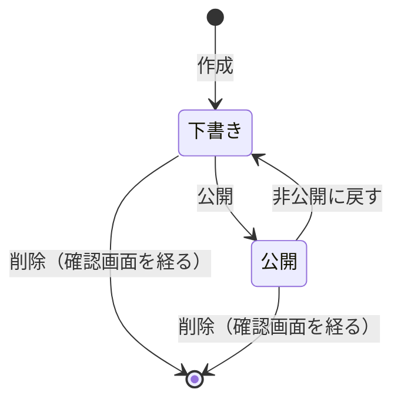
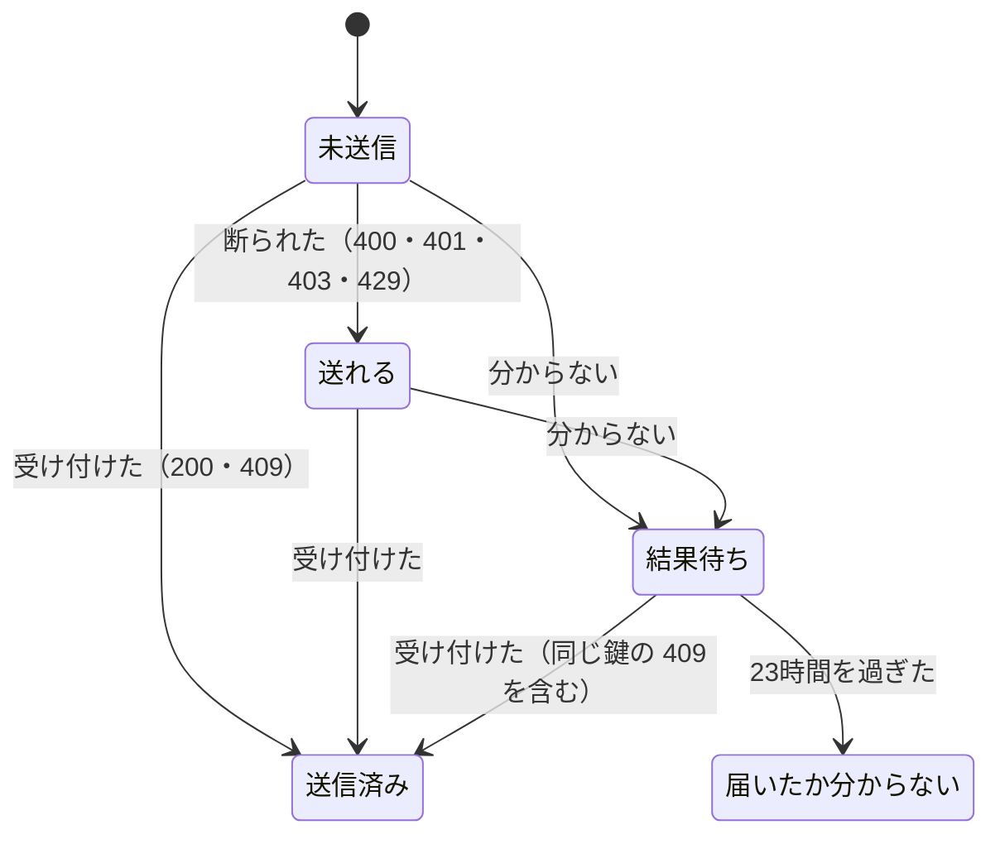

# ドメインモデル: お知らせ機能（features/news）

お知らせ機能の今の仕様の正本です。用語・概念・状態・不変条件・権限をここにまとめます。旧称は「CMS」（`features/cms`）です。変更の経緯は `docs/plans/cms-plan.md`（計画書、旧称のまま）、保存する列の詳細は `docs/data-inventory.md` の5節にあります。管理画面のログインは管理者認証に任せており、その仕様は `docs/domain/auth.md` にあります。

不変条件の番号（`NEWS-INV-n`）の扱いは `docs/domain/auth.md` と同じです。確かめるテスト関数のコメントに番号を書き、`test/domain_test.go` が対応を確かめます。番号は使い回しません。

## 1. 用語

| 用語 | 英語名 | 意味 |
|---|---|---|
| 記事（お知らせ） | `Post` | タイトルと本文を持つ1件。扱う種類はお知らせ1つだけ |
| 下書き | `draft` | 公開側に出ない状態（`status = draft`） |
| 公開 | `published` | 公開側に出してよい状態（`status = published`） |
| カテゴリ | `Category` | 記事の分類。1記事に1つか、無し。お知らせ専用で、カタログの分類とは共有しない |
| 公開日時 | `PublishedAt` | 公開側に記事の日付として出す日時。公開側に出るのは、この日時を過ぎてから |
| 予約公開 | — | 公開の状態で、公開日時が未来の記事。公開日時を過ぎるまで公開側に出ない |
| 公開側 | — | 公開ページ（`/news`・`/news/{id}`）、読み取りAPI（`/api/news`）、`sitemap.xml` |
| 管理側 | — | 記事の管理画面（`/admin/news`）と、カテゴリの管理画面（`/admin/news-categories`） |
| LINE での知らせ | — | 公開側に出ている記事の題名と URL を、LINE 公式アカウントの友だち全員へ一斉送信（broadcast）で送ること。1記事に1回だけ。設定したサイトだけで使える |
| 送った記録 | `lineRecord` | 記事ごとの LINE での知らせの記録（`news_line_broadcasts`）。再送の鍵・送る文面・送信の状況を持つ |
| 再送の鍵 | `retry_key` | LINE の `X-Line-Retry-Key` に付ける UUID。同じ鍵の要求は、LINE の側で24時間のあいだ1回に絞られる |
| 受け付けたかもしれない | `uncertain` | 一斉送信の要求に、LINE が受け付けたかどうか分からない応答（時間切れ、5xx 等）が返ったこと |

## 2. 概念と関係

```
記事（news_posts）── 持ち主なし（サイトに1つの記事の集まり）
  └─ カテゴリ（news_categories）── 0か1つ。消すと記事はカテゴリなしになる
管理側の操作 ── 管理者認証のアカウント（AdminSession）。記事にはアカウントを記録しない
```

- 記事は匿名の所有者（OwnerID）にも、管理者認証のアカウントにも紐づかない。誰が書いたかは保存しない。
- 公開側と管理側は同じストア（`PostStore`）を使い、表示の層だけが違う。公開側の読み出しは、必ず「公開中」の条件付きの関数（`GetPublished`・`ListPublished`・`PublishedRefs`）を通す。

## 3. 状態の移り変わり



- 公開の状態で、公開日時が今以前なら公開側に出る。未来なら予約公開になる。
- 公開日時は、作成・編集で指定できる。指定が無ければ、初めて公開したときの日時になる。
- 管理画面の日時はサーバーのタイムゾーンで読む。編集で空欄にしても、今の公開日時は消さない。APIの日時はUTCのRFC3339で返す。
- 予約公開の記事は、公開日時を過ぎると、操作なしで公開側に出る（読み出しのたびに今の日時と比べる）。

### LINE での知らせの状態

送った記録の項目から決める（`lineRecord.state`）。時刻はサーバーの Unix 秒で比べ、`今 < 今の鍵の最初の要求 + 23時間` のときだけ「23時間のうち」とする（LINE の鍵の24時間との時刻のずれを見込む）。

| 状態 | 条件 | 送れるか |
|---|---|---|
| 未送信 | 記録が無い | 送れる。新しい鍵と、確認の画面で見せた文面で記録を作る |
| 送れる | 記録があり、`sent_at` が無く、`in_flight` が0、`uncertain` が0（前の要求はすべて LINE が受け付けなかった） | 送れる。今の鍵の最初の要求から23時間を過ぎていれば、鍵だけを新しくする |
| 結果待ち | `sent_at` が無く、`in_flight` が1以上か `uncertain` が1、23時間のうち | 同じ鍵と文面でだけ送れる |
| 届いたか分からない | 結果待ちの条件で、23時間を過ぎた | 送れない |
| 送信済み | `sent_at` がある | 送れない |



送る手順（`handleLineSend`）:

1. トークンを発行する（`https://api.line.me/oauth2/v3/token`、チャネル ID とシークレット。15分有効で、保存しない）。失敗したら記録を変えずに断る。
2. 1つのトランザクション（`lineStore.prepare`）で、記事が公開側に出ているかと記録の状態を確かめ、記録を作るか鍵を入れ替え、`in_flight` を1増やしてコミットする。コミットできなければ送らない。
3. トランザクションの外で、保存した文面を保存した鍵で一斉送信する（`https://api.line.me/v2/bot/message/broadcast`）。
4. 応答で記録を直す（`lineStore.finish`）。送信済みでない記録だけを直し、`in_flight` を1減らす。200 と、`x-line-accepted-request-id` の見出しのある 409 は送信済みにする。400・401・403・429 は記録を変えない（LINE は、エラーを返したときは送信しないと説明している）。それ以外の応答・時間切れ・接続の失敗は `uncertain` を1にする。送信済みの記録は変えない。

送った後の書き込みに失敗したときと、要求の途中でプロセスが止まったときは、`in_flight` が残るため結果待ちになる。23時間のうちにもう一度送れば、同じ鍵なので重ならず、受け付け済みなら 409 で送信済みになる。

## 4. 不変条件

| 番号 | 条件 | 守る場所 |
|---|---|---|
| NEWS-INV-1 | 公開側に出るのは、公開の状態で、公開日時を過ぎた記事だけ。下書きと、公開日時前の予約公開は、ページ・一覧・API・`sitemap.xml` のどれにも出ない | `GetPublished`・`ListPublished`・`PublishedRefs` のSQLの条件 |
| NEWS-INV-2 | 公開日時は、初めて公開したときに一度だけ決まり、非公開に戻して再公開しても変わらない（作成・編集で明示的に指定した場合を除く） | `Publish` の `COALESCE(published_at, ?)` |
| NEWS-INV-3 | 記事のIDは、削除した後も再利用しない（APIの利用側の誤参照を防ぐ） | `news_posts` の AUTOINCREMENT |
| NEWS-INV-4 | タイトルは改行とタブのない1〜200字、本文は50,000字以内の文章で、満たさない入力は保存しない | `normalizePost` |
| NEWS-INV-5 | タイトル・本文はプレーンテキストとして扱い、HTMLは文字として表示する。本文で読む記法は行の中のリンク `[文字](URL)` だけで、URLは許可したもの（`https://` とサイト内のパス）だけをリンクにする | `html/template` の自動エスケープ（`template.HTML` を使わない）、`LinkLine`（[本文の書き方](../richtext.md) 7節） |
| NEWS-INV-6 | 公開側は、Coreの匿名セッションのCookieを照合・発行・消去しない | 独立経路（`RegisterIsolatedRoutes`） |
| NEWS-INV-7 | APIが返す項目は、公開用の `id`・`title`・`body`・`published_at`・`updated_at` だけ | `apiPost` |
| NEWS-INV-8 | 別のオリジンからのAPIの読み取りは、`NEWS_CORS_ORIGINS` で許可した接続元だけに許す。既定は許可なし、資格情報は許可しない。`Vary: Origin` を付け、事前要求（OPTIONS）に答える。HTMLのページにはCORSのヘッダーを出さない | `LoadConfig`・APIのハンドラ |
| NEWS-INV-9 | 管理側の画面と送信は、すべて管理者認証の `Page`・`Form`（ログイン・同一オリジン・CSRF）で守る。管理者認証が無ければ起動を止める | `registerPostAdminRoutes`・`registerCategoryAdminRoutes`、`internal/app` の `BuildRoutes` |
| NEWS-INV-10 | 記事は、Coreのセッションの破棄・GCでも、マイグレーションの再実行でも消えない | `news_posts` を `owners` に紐づけない、`CREATE TABLE IF NOT EXISTS` |
| NEWS-INV-11 | タイトル・本文・リクエストの値・設定値は、ログにもAPIのエラーにも出さない | `requestID`（ログには要求の番号と記事の番号だけを出す）、固定のエラー文言 |
| NEWS-INV-12 | 記事を変える操作はGETで行わない。削除は確認画面を経てPOSTで行う | `registerPostAdminRoutes` |
| NEWS-INV-13 | URLの記事の番号は、正の整数の標準の書き方だけを受け付ける。`01`・`+1`・`abc` 等は、ページでもAPIでも、400ではなく「無い」（404）として扱う | `web.PathID` |
| NEWS-INV-14 | カテゴリの名前は改行とタブの無い1〜50字で、同じ名前のカテゴリは2つ作れない。改名・削除で記事の更新日時は変えない | `SaveCategory`、`news_categories.name` の UNIQUE |
| NEWS-INV-15 | 記事に付けられるのは、あるカテゴリだけ（無い番号は保存しない）。管理画面とMCPの両方で、保存と同じトランザクションで確かめる。カテゴリを消しても記事は消えず、カテゴリなしになる | `checkCategory`（`CreateWithCover`・`UpdateWithCover`・`UpdateWithCategory`・`UpdateIfUnchanged`）・`DeleteCategory`、`ON DELETE SET NULL` |
| NEWS-INV-16 | 公開側の絞り込みの候補と結果は、記事の公開ページと同じ条件（状態と公開日時）で決める。下書きと公開日時前の記事しか持たないカテゴリは候補に出さず、その番号を指定しても記事を出さない | `PublicCategories`・`ListPublishedIn` |
| NEWS-INV-17 | MCPの編集（`news_update`）で `category_id` を省いたら、記事のカテゴリを変えない。0ならカテゴリを外す。カテゴリを知らない前の版のクライアントが本文だけを直しても、付いているカテゴリは消えない | `postArgs.CategoryID`（省略は `nil`）、`UpdateIfUnchanged` |
| NEWS-INV-18 | MCPの作成・編集でカテゴリを付けるときは、確認の文に見せたカテゴリの名前を確認に結び付け、保存のトランザクションの中で、そのカテゴリが同じ名前のままかを確かめる。確認の後に改名・削除されていれば保存しない（競合）。作成でカテゴリを付けるときは、確認の文の3行目の変更する欄にも「カテゴリ」を出す | `categoryState`・`checkCategoryName` |
| NEWS-INV-19 | LINE へ送るのは、送る前のトランザクションの中で公開側に出ていた記事だけ（NEWS-INV-1 と同じ条件）。送る文面は、サイト名・題名・記事の URL だけで作る。確認の画面で見せた文面と、送るときに作った文面が違えば、記録を作らない | `lineStore.prepare`・`lineMessage` |
| NEWS-INV-20 | 鍵と文面をコミットしてからでないと一斉送信しない。送信済みと、届いたか分からない記録は、もう送らない | `lineStore.prepare`・`handleLineSend` |
| NEWS-INV-21 | 受け付けたかもしれない要求があった記録（`uncertain` が1か `in_flight` が1以上）は、鍵と文面を変えず、今の鍵の最初の要求から23時間のうちだけ送り直す。受け付けなかったと分かっている要求だけの記録に限り、23時間の後に鍵を入れ替える。文面は作り直さない | `lineRecord.state`・`lineStore.prepare` |
| NEWS-INV-22 | 送信済みの記録は、後から返った応答で変えない | `lineStore.finish` |
| NEWS-INV-23 | LINE での知らせは、サイト管理者以上の管理画面からだけ送れる。MCPのツールにも、GETにも、送る操作を置かない | `registerLineRoutes` |
| NEWS-INV-24 | LINE への要求は、トークンの発行と一斉送信の2つの URL だけに送り、転送に従わない。チャネルシークレットは所有者だけが読めるファイルから読む。シークレット・トークン・応答の本文・エラーの文を、ログと画面に出さない。トークンは保存しない | `newLineClient`・`loadLineConfig`・`lineSecret` |
| NEWS-INV-25 | `LINE_CHANNEL_ID` と `LINE_CHANNEL_SECRET_FILE` の両方を設定しなければ、LINE の画面も送る操作も出さず、外へ通信しない。片方だけ、または `SITE_URL`・`SITE_NAME` が無いときは起動を止める | `loadLineConfig`・`registerLineRoutes` |

公開の一覧 `/news` は `?category=ID` で1つのカテゴリに絞り込める（`page` と併用でき、ページ送りは条件を残す）。番号の形が正しくない・2つ以上ある場合は400。`CanonicalPath` は `/news` のまま。カテゴリは公開の詳細に名前と絞り込みへのリンクで出し、APIの項目には足さない（NEWS-INV-7）。

MCPでは、`news_categories` で付けられるカテゴリの番号と名前を読み、`news_create`・`news_update` の `category_id` で付け外しする。`news_create` で省くか0ならカテゴリなし。`news_update` は省くと変えない（NEWS-INV-17。カタログの `catalog_update` は必須の欄で、わざと形を変えている）。無い番号は確認の前に断り、確認の後に消された場合も保存しない（NEWS-INV-15）。確認の文は、作成ではカテゴリの名前を対象の行に出して変更する欄にも「カテゴリ」を足し、編集ではカテゴリが変わるときだけ「カテゴリ: 前 → 後」を出す。付けようとしたカテゴリが確認の後に改名・削除されたら保存しない（NEWS-INV-18）。`news_get`・`news_list` はカテゴリの番号（`category_id`）と名前（`category`）を返し、カテゴリが無ければ省く。カテゴリの追加・改名・削除はMCPではできず、管理画面だけで行う。確認のハッシュと条件付きの保存の条件にはカテゴリを含めるので、確認の後に記事のカテゴリが変わったら保存しない（MCP-INV-4）。

一覧APIは `limit`（既定20、上限50）と `offset`（0〜100,000）を受け取り、不正な値は400にする。応答は `items`・`limit`・`offset`・`next_offset` で、公開日時の新しい順、同時刻ならIDの大きい順に並べる。`sitemap.xml` には同じ順で49,000件まで載せる。

## 5. 権限

| 操作 | システム管理者 | サイト管理者 | ログインなし |
|---|---|---|---|
| 公開側の閲覧（ページ・API） | ○ | ○ | ○ |
| 記事の作成・編集・公開・非公開・予約公開・削除 | ○ | ○ | × |
| カテゴリの追加・改名・削除 | ○ | ○ | × |
| LINE での知らせ（設定したサイトだけ） | ○ | ○ | × |

記事の管理は、管理者認証の両方のロールに許します（`Page`・`Form` を使い、`AdminPage`・`AdminForm` は使わない）。記事ごとの持ち主や、編集・公開の権限の分離はありません。MCPのお知らせのツール（カテゴリの一覧と付け外しを含む）も同じ2つのロールの接続だけが使え、一般ユーザーの接続には出ません（[MCPの仕様](mcp.md) の MCP-INV-11）。

## 6. 他の機能との関係

- 管理者認証（`features/auth`）の `features.Admin` の口だけを使い、`auth_*` の表を読まない。`make add-news` で管理者認証も有効になり、お知らせ機能が有効な間は `make remove-auth` できない。
- Siteが有効なら、ナビに「お知らせ」のリンクを出し、Siteのヘッダー・フッターで公開ページを描く（`NavLinkFeature`・`LayoutConsumer`）。`sitemap.xml` には公開中の記事を載せる（`SitemapFeature`）。
- 画像機能が有効なら、記事に代表画像を1枚付けられる（[画像の仕様](media.md)）。公開の詳細の見出しの下に出し、一覧とAPIには出さない。
- HTTPの外の道具（移行の道具 `cmd/wpimport` 等）は、`Posts` で記事のストアを受け取り、管理画面と同じ `CreateWithCover`・`UpdateWithCover`・`SaveCategory` を通す。SQLを直接書かない。
- 本文はプレーンテキストで、公開の詳細では行の中のリンクの記法 `[文字](URL)` だけを読む（[本文の書き方](../richtext.md) 7節）。強調・見出し・リストは読まない。`\` で `\`・`[`・`]`・`(`・`)` を文字にできる。説明文（検索結果・SNSのカード）はリンクを読んだ後の文字から作る。APIとMCPは本文を記法の文字のまま返す。

## 7. 守らない範囲

- 記事の種類の追加、本文の中の画像、リンク以外のMarkdown・HTMLの本文、書き込みAPI・APIトークン、下書きのAPI。
- 記事ごとの権限・承認の流れ、変更の履歴・版の管理、誰が書いたかの記録。
- 公開側の60秒のキャッシュによる反映の遅れ（公開・非公開・予約公開の切り替わりは、最大でその時間だけ遅れて見える）。
- LINE での知らせの、個別の送信・友だちの管理・Webhook の受信・リッチメニュー・画像・送信の予約・通知の音を消す選択・残りの通数の表示・カタログや固定ページからの送信。個別のやり取りは LINE 公式アカウントの管理画面かアプリで行う。
- 送った後の取り消し、LINE の側での届き方（ブロックした人には届かない等）、月の通数の管理。
- 届いたか分からない記事の送り直し。LINE 公式アカウントの管理画面か友だちのトークで確かめ、届いていなければ LINE の管理画面から送る。
- 送る操作の後、一斉送信までの間に記事が非公開・削除された場合。送る前のトランザクションで公開中なら送る（送る操作と非公開・削除を排他にしない）。削除された記事の記録は一緒に消える。
- 記録を作った後に題名を直しても、送る文面は変わらない（LINE は送り直しで中身を変えないよう求めている）。
