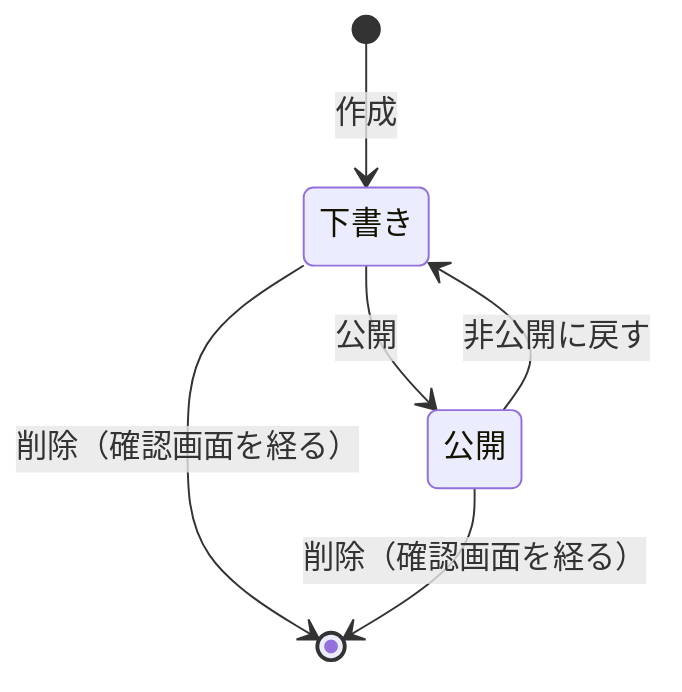

# ドメインモデル: お知らせ機能（features/news）

お知らせ機能の今の仕様の正本です。用語・概念・状態・不変条件・権限をここにまとめます。旧称は「CMS」（`features/cms`）です。変更の経緯は `docs/plans/cms-plan.md`（計画書、旧称のまま）、保存する列の詳細は `docs/data-inventory.md` の5節にあります。管理画面のログインは管理者認証に任せており、その仕様は `docs/domain/auth.md` にあります。

不変条件の番号（`NEWS-INV-n`）の扱いは `docs/domain/auth.md` と同じです。確かめるテスト関数のコメントに番号を書き、`test/domain_test.go` が対応を確かめます。番号は使い回しません。

## 1. 用語

| 用語 | 英語名 | 意味 |
|---|---|---|
| 記事（お知らせ） | `Post` | タイトルと本文を持つ1件。扱う種類はお知らせ1つだけ |
| 下書き | `draft` | 公開側に出ない状態（`status = draft`） |
| 公開 | `published` | 公開側に出してよい状態（`status = published`） |
| カテゴリ | `Category` | 記事の分類。1記事に1つか、無し。お知らせ専用で、カタログの分類とは共有しない |
| 公開日時 | `PublishedAt` | 公開側に記事の日付として出す日時。公開側に出るのは、この日時を過ぎてから |
| 予約公開 | — | 公開の状態で、公開日時が未来の記事。公開日時を過ぎるまで公開側に出ない |
| 公開側 | — | 公開ページ（`/news`・`/news/{id}`）、読み取りAPI（`/api/news`）、`sitemap.xml` |
| 管理側 | — | 記事の管理画面（`/admin/news`）と、カテゴリの管理画面（`/admin/news-categories`） |

## 2. 概念と関係

```
記事（news_posts）── 持ち主なし（サイトに1つの記事の集まり）
  └─ カテゴリ（news_categories）── 0か1つ。消すと記事はカテゴリなしになる
管理側の操作 ── 管理者認証のアカウント（AdminSession）。記事にはアカウントを記録しない
```

- 記事は匿名の所有者（OwnerID）にも、管理者認証のアカウントにも紐づかない。誰が書いたかは保存しない。
- 公開側と管理側は同じストア（`PostStore`）を使い、表示の層だけが違う。公開側の読み出しは、必ず「公開中」の条件付きの関数（`GetPublished`・`ListPublished`・`PublishedRefs`）を通す。

## 3. 状態の移り変わり



- 公開の状態で、公開日時が今以前なら公開側に出る。未来なら予約公開になる。
- 公開日時は、作成・編集で指定できる。指定が無ければ、初めて公開したときの日時になる。
- 管理画面の日時はサーバーのタイムゾーンで読む。編集で空欄にしても、今の公開日時は消さない。APIの日時はUTCのRFC3339で返す。
- 予約公開の記事は、公開日時を過ぎると、操作なしで公開側に出る（読み出しのたびに今の日時と比べる）。

## 4. 不変条件

| 番号 | 条件 | 守る場所 |
|---|---|---|
| NEWS-INV-1 | 公開側に出るのは、公開の状態で、公開日時を過ぎた記事だけ。下書きと、公開日時前の予約公開は、ページ・一覧・API・`sitemap.xml` のどれにも出ない | `GetPublished`・`ListPublished`・`PublishedRefs` のSQLの条件 |
| NEWS-INV-2 | 公開日時は、初めて公開したときに一度だけ決まり、非公開に戻して再公開しても変わらない（作成・編集で明示的に指定した場合を除く） | `Publish` の `COALESCE(published_at, ?)` |
| NEWS-INV-3 | 記事のIDは、削除した後も再利用しない（APIの利用側の誤参照を防ぐ） | `news_posts` の AUTOINCREMENT |
| NEWS-INV-4 | タイトルは改行とタブのない1〜200字、本文は50,000字以内の文章で、満たさない入力は保存しない | `normalizePost` |
| NEWS-INV-5 | タイトル・本文はプレーンテキストとして扱い、HTMLは文字として表示する。本文で読む記法は行の中のリンク `[文字](URL)` だけで、URLは許可したもの（`https://` とサイト内のパス）だけをリンクにする | `html/template` の自動エスケープ（`template.HTML` を使わない）、`LinkLine`（[本文の書き方](../richtext.md) 7節） |
| NEWS-INV-6 | 公開側は、Coreの匿名セッションのCookieを照合・発行・消去しない | 独立経路（`RegisterIsolatedRoutes`） |
| NEWS-INV-7 | APIが返す項目は、公開用の `id`・`title`・`body`・`published_at`・`updated_at` だけ | `apiPost` |
| NEWS-INV-8 | 別のオリジンからのAPIの読み取りは、`NEWS_CORS_ORIGINS` で許可した接続元だけに許す。既定は許可なし、資格情報は許可しない。`Vary: Origin` を付け、事前要求（OPTIONS）に答える。HTMLのページにはCORSのヘッダーを出さない | `LoadConfig`・APIのハンドラ |
| NEWS-INV-9 | 管理側の画面と送信は、すべて管理者認証の `Page`・`Form`（ログイン・同一オリジン・CSRF）で守る。管理者認証が無ければ起動を止める | `registerPostAdminRoutes`・`registerCategoryAdminRoutes`、`internal/app` の `BuildRoutes` |
| NEWS-INV-10 | 記事は、Coreのセッションの破棄・GCでも、マイグレーションの再実行でも消えない | `news_posts` を `owners` に紐づけない、`CREATE TABLE IF NOT EXISTS` |
| NEWS-INV-11 | タイトル・本文・リクエストの値・設定値は、ログにもAPIのエラーにも出さない | `requestID`（ログには要求の番号と記事の番号だけを出す）、固定のエラー文言 |
| NEWS-INV-12 | 記事を変える操作はGETで行わない。削除は確認画面を経てPOSTで行う | `registerPostAdminRoutes` |
| NEWS-INV-13 | URLの記事の番号は、正の整数の標準の書き方だけを受け付ける。`01`・`+1`・`abc` 等は、ページでもAPIでも、400ではなく「無い」（404）として扱う | `web.PathID` |
| NEWS-INV-14 | カテゴリの名前は改行とタブの無い1〜50字で、同じ名前のカテゴリは2つ作れない。改名・削除で記事の更新日時は変えない | `SaveCategory`、`news_categories.name` の UNIQUE |
| NEWS-INV-15 | 記事に付けられるのは、あるカテゴリだけ（無い番号は保存しない）。カテゴリを消しても記事は消えず、カテゴリなしになる | `checkCategory`・`DeleteCategory`、`ON DELETE SET NULL` |
| NEWS-INV-16 | 公開側の絞り込みの候補と結果は、記事の公開ページと同じ条件（状態と公開日時）で決める。下書きと公開日時前の記事しか持たないカテゴリは候補に出さず、その番号を指定しても記事を出さない | `PublicCategories`・`ListPublishedIn` |

公開の一覧 `/news` は `?category=ID` で1つのカテゴリに絞り込める（`page` と併用でき、ページ送りは条件を残す）。番号の形が正しくない・2つ以上ある場合は400。`CanonicalPath` は `/news` のまま。カテゴリは公開の詳細に名前と絞り込みへのリンクで出し、APIの項目には足さない（NEWS-INV-7）。MCPはカテゴリを変えず、読み取りで名前を返す。確認のハッシュと条件付きの保存の条件にはカテゴリを含める。

一覧APIは `limit`（既定20、上限50）と `offset`（0〜100,000）を受け取り、不正な値は400にする。応答は `items`・`limit`・`offset`・`next_offset` で、公開日時の新しい順、同時刻ならIDの大きい順に並べる。`sitemap.xml` には同じ順で49,000件まで載せる。

## 5. 権限

| 操作 | システム管理者 | サイト管理者 | ログインなし |
|---|---|---|---|
| 公開側の閲覧（ページ・API） | ○ | ○ | ○ |
| 記事の作成・編集・公開・非公開・予約公開・削除 | ○ | ○ | × |
| カテゴリの追加・改名・削除 | ○ | ○ | × |

記事の管理は、管理者認証の両方のロールに許します（`Page`・`Form` を使い、`AdminPage`・`AdminForm` は使わない）。記事ごとの持ち主や、編集・公開の権限の分離はありません。

## 6. 他の機能との関係

- 管理者認証（`features/auth`）の `features.Admin` の口だけを使い、`auth_*` の表を読まない。`make add-news` で管理者認証も有効になり、お知らせ機能が有効な間は `make remove-auth` できない。
- Siteが有効なら、ナビに「お知らせ」のリンクを出し、Siteのヘッダー・フッターで公開ページを描く（`NavLinkFeature`・`LayoutConsumer`）。`sitemap.xml` には公開中の記事を載せる（`SitemapFeature`）。
- 画像機能が有効なら、記事に代表画像を1枚付けられる（[画像の仕様](media.md)）。公開の詳細の見出しの下に出し、一覧とAPIには出さない。
- HTTPの外の道具（移行の道具 `cmd/wpimport` 等）は、`Posts` で記事のストアを受け取り、管理画面と同じ `CreateWithCover`・`UpdateWithCover`・`SaveCategory` を通す。SQLを直接書かない。
- 本文はプレーンテキストで、公開の詳細では行の中のリンクの記法 `[文字](URL)` だけを読む（[本文の書き方](../richtext.md) 7節）。強調・見出し・リストは読まない。`\` で `\`・`[`・`]`・`(`・`)` を文字にできる。説明文（検索結果・SNSのカード）はリンクを読んだ後の文字から作る。APIとMCPは本文を記法の文字のまま返す。

## 7. 守らない範囲

- 記事の種類の追加、本文の中の画像、リンク以外のMarkdown・HTMLの本文、書き込みAPI・APIトークン、下書きのAPI。
- 記事ごとの権限・承認の流れ、変更の履歴・版の管理、誰が書いたかの記録。
- 公開側の60秒のキャッシュによる反映の遅れ（公開・非公開・予約公開の切り替わりは、最大でその時間だけ遅れて見える）。
