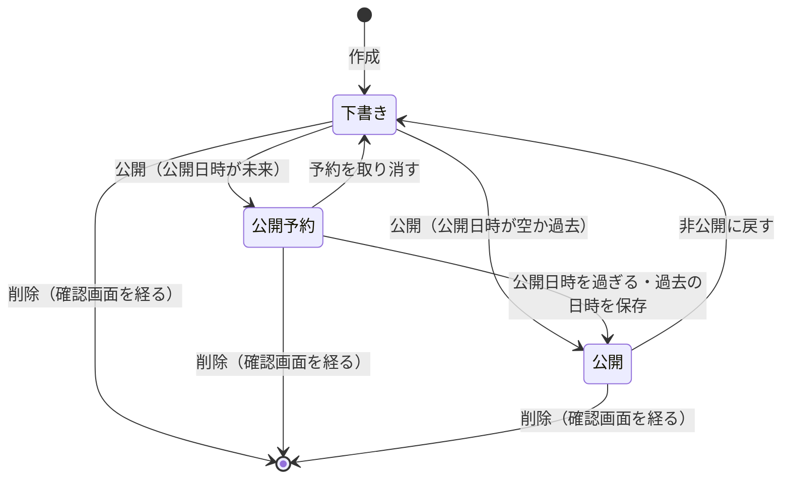

# ドメインモデル: 固定ページ（features/pages）

現在の仕様の正本。変更の経緯は [pages-plan.md](../plans/pages-plan.md)、本文の書き方は [richtext.md](../richtext.md)、保存データは [data-inventory.md](../data-inventory.md) の8節。不変条件は対応するテスト関数のコメントと機械的に突き合わせる。番号は使い回さない。

## 1. 用語

| 用語 | 英語名 | 意味 |
|---|---|---|
| 固定ページ | `Page` | `/{スラッグ}` で公開する1件。タイトル・本文（書き方を絞ったMarkdown）・状態・ナビに出す順を持つ |
| スラッグ | `Slug` | URLの `/` の後ろ。英小文字・数字・ハイフンで2〜40文字。ハイフンで始まり・終わらない |
| ナビの順 | `nav_order` | ナビに出す順の小さい順に並べ、同じ順ならURLの順にする。順が空のページはナビに出さない |
| 公開予約 | `Scheduled` | 公開の状態で、公開日時（`publish_at`）がまだ来ていないページ。公開ページとナビには出さない |
| 受け皿 | `FallbackFeature` | Coreと機能のどの経路にも当たらなかったGET・HEADを受ける口。固定ページの公開ページはここで返す |

## 2. 概念と関係

固定ページはサイト全体の共有内容で、匿名OwnerIDやシステム管理者アカウントの所有物ではない。

## 3. 状態の移り変わり

- 公開予約は、保存の上では公開（`status = published`）で、公開日時（`publish_at`）がまだ来ていない状態。公開ページには、下書きと同じく出さない。判定は要求のたびにその時刻で行い、状態を書き換える処理は無い。
- 公開日時は、編集の画面で保存してから「公開を予約する」を押す。公開の操作は保存済みの日時に従う。
- 空欄で保存しても、今の公開日時は変えない。予約をやめるのは「予約を取り消す（下書きに戻す）」で、公開日時も消す。下書きに付いた日時も、空欄の保存では消えない。
- 予約中に過去の日時を保存すると、その保存で公開ページに出る。管理画面は完了の案内で、MCPは確認の文で伝える。
- 公開ページに出ているものを未来の日時にする保存は拒否する。先に非公開に戻す。
- お知らせと違い、非公開に戻すと公開日時を消す。お知らせの公開日時は記事の日付として表示するので残すが、カタログと固定ページの公開日時は公開を始める時刻だけを表す。

作成・編集だけでは公開しない。プレビューは状態を変えない。

## 4. 不変条件

| 番号 | 条件 | 守る場所 |
|---|---|---|
| PAGES-INV-1 | 公開ページに出るのは、公開の状態で公開日時を過ぎたページだけ（予約中は下書きと同じ）。下書き・存在しないページ・2階層のパス・書式に合わないパスは同じ404 | `publicPage`・`Store.Published`・`HandleFallback`・`slugPattern` |
| PAGES-INV-2 | 本文は構造に読んでから部品で描き、利用者の入力をHTMLとして出さない。リンクは richtext.md 5節の許可のものだけ | `ParseWithImages`・`HandleFallback` |
| PAGES-INV-3 | スラッグは決まった形で、登録済みの経路・固定の予約語と重ならず、重複しない | `normalize`・`reservedSlugs`・`uniqueError`・`UNIQUE` |
| PAGES-INV-4 | 管理操作は管理者認証の Page・Form で守り、変更はPOSTだけ | `registerAdmin`（`Page`・`Form`） |
| PAGES-INV-5 | 公開ページはCookieを発行・照合しない。固定ページを有効にしても、Coreと機能の経路は取られない | `HandleFallback`・`RegisterIsolatedRoutes` |
| PAGES-INV-6 | ナビとsitemapに出るのは公開日時を過ぎた公開中のページだけで、予約中のページは公開日時を過ぎた後の最初の描画からナビに載る。ナビの作り直しは直列に行い、古い読み取りが新しい結果を上書きしない。変更は再起動なしで反映される。作り直しに失敗したら、古いリンクを残さず固定ページのリンクをナビから外し、定期のGCか次の変更で戻す | `DynamicNavLinks`・`rebuildMu`・`refreshNav`・`afterChange`・`Purge`・`SitemapEntries` |
| PAGES-INV-7 | ページはCoreのセッションの破棄やマイグレーションの再実行で消えない | `migration.sql`（所有者の列を持たない） |
| PAGES-INV-8 | タイトル・本文・スラッグをログに出さない | `Page.LogValue`・`Input.LogValue` |
| PAGES-INV-9 | プレビューは保存も公開状態の変更もしない（`updated_at` も変えない）。入力に誤りがあれば描かず400にする | `handlePreview` |
| PAGES-INV-10 | 404は、ページが無いときだけ返す。取得の失敗は500にして記録し、障害の間に公開中のページを「無い」と扱わない | `HandleFallback` |
| PAGES-INV-12 | 本文の最初の空でない行がヒーローの行なら、ページの題名をヒーローの見出しとして描き、題名の `h1` は1つだけにする。説明文（`description`）はヒーローの導入から作る。ボタンは本文のリンクと同じURLの許可を通り、同じタブで開く。社内文書の本文では、LPの部品の行は段落のまま（[richtext.md](../richtext.md) の2.2節） | `ParseForPages`・`page.html`・`description` |
| PAGES-INV-13 | LPの部品の読み方を足す前に保存した本文に、部品の前置きで始まる行があれば、起動の時にページのIDだけを警告のログに出す（本文は出さず、何も変えない） | `warnLPLines`・`LPLinePages` |
| PAGES-INV-11 | 空欄の保存は公開日時を変えない。公開ページに出ているページを未来の日時にする保存は、保存のトランザクションの中の今の行と時刻で判定して拒否する。非公開に戻すと公開日時を消す。予約中に過去の日時を保存すると、その保存で公開になり、そのことを利用者に伝える。MCPの照合は公開日時も含める | `checkPublishAt`・`SetPublishedIfUnchanged` |

## 5. 権限

| 操作 | システム管理者 | サイト管理者 | 未ログイン |
|---|---|---|---|
| 公開ページの閲覧 | 可 | 可 | 可 |
| 作成・編集・プレビュー・公開・削除 | 可 | 可 | 不可 |

## 6. 他の機能との関係

- 管理者認証（`features/auth`）の `features.Admin` の口だけを使う。`make add-pages` で管理者認証も有効になり、固定ページが有効な間は `make remove-auth` できない。
- 公開ページは、Coreと他の機能のどの経路にも当たらなかった要求だけを受け皿（`FallbackFeature`）で受ける。スラッグが登録済みの経路と重ならないかは、配線から受け取る関数（`RouteCheckConsumer`）で確かめる。
- Siteが有効なら、Siteのヘッダー・フッターで描き（`LayoutConsumer`）、無いページにはSiteの404を返す（`NotFoundConsumer`）。公開中でナビに出す順を決めたページはナビに載る（`DynamicNavLinkFeature`）。`sitemap.xml` には、順の有無にかかわらず公開中のページを載せる（`SitemapFeature`）。
- お知らせ・カタログとはデータを共有しない。本文を読む部品（`internal/web/richtext`）はCoreにあり、お知らせ・カタログの本文はリンクの記法だけを同じ部品で読む（[本文の書き方](../richtext.md) 7節）。
- HTTPの外の道具（移行の道具 `cmd/wpimport` 等）は、`Import`（管理画面と同じ `save` を通す下書きの作成）、`CheckSlug`・`Slugs`（取り込む前のスラッグの確かめ）を使う。SQLを直接書かない。
- 画像機能が有効なら、本文に画像の行を書ける（[画像の仕様](media.md)、[本文の書き方](../richtext.md)）。編集の画面のボタンで本文の末尾に足し、プレビューは管理者の経路で描く。画像機能が無い構成では、画像の行は説明の文字として描く。

## 7. 守らない範囲

- ファイルの添付、HTMLの直接入力、2階層以上のURL、版の履歴、公開の終了日時、ページごとのレイアウトの選択。
- 予約公開の時刻ちょうどの反映。トップ等と `sitemap.xml` の公開キャッシュ（60秒）の間は、前のナビが見えることがある。一度公開した画像は、非公開に戻してもCDNとブラウザに最長1日残りうる。
- スラッグを変えたときの旧URLからの転送、検索結果用の説明文の列（本文の冒頭から作る）。
- 静的書き出し（固定ページを有効にすると `export-static` は使えない）。
- 作者・操作の記録、ページごとの権限・承認の流れ。
- Markdownとの完全な互換、リンク先の外部サイトの安全（本文で読む規則と許すリンクは [richtext.md](../richtext.md)）。
