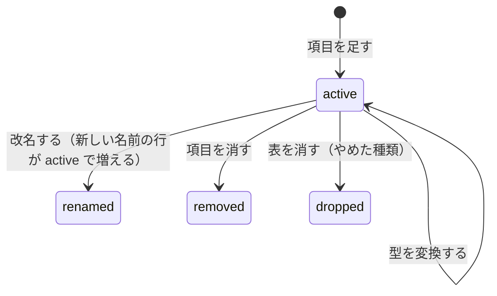

# ドメインモデル: 業務記録（features/records）

業務記録の今の仕様の正本です。変更の経緯は [records-plan.md](../plans/records-plan.md)、保存データは [data-inventory.md](../data-inventory.md) の業務記録の節（定義から生成）、ロールとログインは [auth.md](auth.md)、MCPの共通の決まりは [mcp.md](mcp.md) にあります。不変条件の番号（`RECORDS-INV-n`）の扱いは `docs/domain/auth.md` と同じです。

この機能は、ほかの機能と違い、扱う項目がコードに固定されていません。アプリの開発者（保守・カスタマイズする会社・個人）が Go のコードで書いた**定義**を読んで、表・画面・MCPのツールを組み立てます。定義は実行ファイルに組み込まれ、ログインした利用者は項目を変えられません。

## 1. 用語

| 用語 | 英語名 | 意味 |
|---|---|---|
| 業務記録 | — | この機能。日報、備品の台帳のような記録の総称 |
| 種類 | `RecordDef` | 記録の1つの型（例: 日報）。名前、表示名、目的、保持、権限の型、MCPに出すか、項目を持つ。種類ごとに表が1つある |
| 定義の一覧 | `recordDefs` | 有効な種類の一覧。ここに無い種類は画面にもMCPにも出ない |
| 項目 | `RecordField` | 種類の1つの欄（例: 日付）。名前、表示名、論理の型、必須、上限を持つ。列 `f_<名前>` に保存する |
| 論理の型 | `FieldType` | `Text`・`LongText`・`Integer`・`Date`・`Select`・`Bool`。DBの列の型より細かい |
| 記録 | — | 種類の表の1行 |
| 所有者 | `owner_account` | 記録を作ったアカウント |
| 権限の型 | `RecordAccess` | `OwnerOnly`・`OwnerWriteAdminRead`・`OwnerWriteAllRead`・`AllReadWrite` のどれか。種類ごとに1つ |
| 版の数 | `revision` | 記録を保存するたびに1増える数。同時の編集を見分ける |
| 昔の名前 | `RenamedFrom` | 項目の過去の名前の一覧。改名の移行に使う。消さない |
| 消した項目 | `RemovedFields` | 定義から消し、列も消す項目の名前の一覧。消さない |
| 前の型 | `TypeChangedFrom` | 項目の過去の論理の型の一覧。型の変換に使う。消さない |
| やめた種類 | `RetiredDefs` | 画面とMCPから外した種類の一覧。表を消した後も、消した印を付けて残す |
| 列の記録 | `records_columns` | DBの中の、その環境に実際に適用した状態の記録。表と列ごとに、論理の型と状態を持つ |
| 列の状態 | `state` | `active`（使っている）、`renamed`（改名した）、`removed`（消した）、`dropped`（表を消した） |
| 定義の記録 | `records.lock.json` | 最後に生成した時の定義の写し。コマンドが書き、人は直さず、コミットする。開発の時に、前の定義との差を調べるのに使う |
| 業務記録の節 | — | `data-inventory.md` の中で、定義から生成する範囲。印で囲む。書き出すだけで、読み返さない |
| 確認のコマンド | `runRecordsCheck` | コマンド `records-check`。デプロイの前に、本番のDBを読むだけで、この実行ファイルが起動したら何をするかを示すコマンド |
| 削除済みの所有者の記録 | — | 所有者のアカウントが削除済み（アカウントの一覧に無い）の記録 |

## 2. 概念と関係

```
定義の一覧 1 ─ n 種類 1 ─ n 項目
                  1 ─ 1 表 1 ─ n 記録
列の記録: 表 1 ─ n 列の状態（環境ごと、DBの中）
定義の記録: 種類と項目の写し（開発の時、リポジトリの中）
```

- 種類の名前と項目名は、英小文字で始まり、英小文字・数字・`_` の30字以内。表名 `records_<種類>`、列名 `f_<項目>` に使う。一度使った名前（昔の名前、消した項目、やめた種類を含む）は、同じ種類の中で別の意味に使い回さない。
- 共通の列は `id`・`owner_account`・`revision`・`created_at`・`updated_at`。項目の列は全部 NULL 可で、必須は保存の時に検査する。
- アカウントIDは認証の表と外部キーでつながない。`features.AccountDirectory` で呼び名と状態を読み、一覧に無いIDは「削除済みのアカウント」、`Disabled` は「停止中」と出す。アカウントの一覧が無い構成では起動を止める。
- **定義**は「あるべき姿」、**列の記録**は「その環境の今の姿」、**定義の記録**は「最後にレビューを通った定義」。起動の時は定義と列の記録を比べ、開発の時は定義と定義の記録を比べる。Markdown は入力にしない。

## 3. 状態の移り変わり

記録には状態の遷移は無い。承認や「貸出中」のような状態が要るなら、`Select` の項目として人が書き換える。

列の記録の状態は、次のように移る。



`renamed`・`removed`・`dropped` から `active` へは戻らない。

## 4. 項目の型と入力

| 型 | 列の型 | 入力欄 | 保存の時の検査 |
|---|---|---|---|
| `Text` | TEXT | 1行 | 文字数の上限 `MaxLen`（既定200）。改行とタブを拒否 |
| `LongText` | TEXT | 複数行 | 文字数の上限 `MaxLen`（既定4000）。表示は改行を保つ平文。記法は無し |
| `Integer` | INTEGER | 数値 | 64ビットの整数。範囲 `Min`・`Max` |
| `Date` | TEXT（`YYYY-MM-DD`） | 日付 | 実在の日付。時刻は持たない |
| `Select` | TEXT | 選択 | 定義の選択肢のどれか |
| `Bool` | INTEGER（0/1） | チェック欄 | — |

- 空の入力は NULL で保存する。必須の項目は空を拒否する。
- 定義を変えて合わなくなった既存の値（上限を超える、選択肢に無い、必須なのに空）は、そのまま表示し、次の保存で直させる。

## 5. 一覧と画面

- 画面は `docs/components.md` の画面の型で作る。種類の一覧、記録の一覧、作成、詳細、編集、削除の確認、削除済みの所有者の記録の一覧と、その削除の確認。
- 絞り込みは、`Text`・`LongText` の語（部分一致。`%`・`_`・`\` は文字として扱う）、`Select` の値、`Date` の期間、「自分の記録だけ」（`OwnerWriteAllRead`・`AllReadWrite`）。
- 並びは、定義の `ListFields` の項目と更新日時から選ぶ。同じ値の中は `id` の新しい順。知らない指定は既定の並びにする。
- ページ送りは「次へ」だけで、全件数は数えない（カタログと同じ）。
- 読めない記録、存在しない種類・記録は、同じ404にする。
- JS は使わない。

## 6. 不変条件

| 番号 | 条件 | 守る場所 |
|---|---|---|
| RECORDS-INV-1 | 全ての画面にログインが要る。停止中のアカウントは使えない。アカウントの一覧が無い構成では起動を止める | `requireRecordsDirectory`・`recordsRoutes` |
| RECORDS-INV-2 | 定義の検査（名前の規則、重複、使い回し、目的と保持が空でない、指す項目が実在する、昔の名前・消した項目・前の型・やめた種類の衝突、許されない型の変換）に通らなければ、起動を止める | `validateRecordDefs` |
| RECORDS-INV-3 | 読めない記録は、一覧、絞り込み、詳細、MCPのどこにも出ず、存在しない種類・記録と同じ404になる | `readableCondition`・`checkRecordAccess` |
| RECORDS-INV-4 | 作成・編集・削除は、権限の型の表（7節）のとおりにだけできる。ロールと状態は要求ごとに読む | `checkRecordAccess` |
| RECORDS-INV-5 | 1件の保存と削除は、開いた時の版の数が今と同じ時だけ行い、照合と書き込みの間に他の書き込みが入らない。違えば何も変えない。画面とMCPで同じ | `updateRecordRevision`・`deleteRecordRevision` |
| RECORDS-INV-6 | 必須・型・上限・選択肢は保存の時に検査する。定義が変わって合わなくなった既存の値は、そのまま表示し、次の保存で直させる | `validateFieldValue` |
| RECORDS-INV-7 | SQLの表名と列名は、検査済みの定義からだけ作り、引用符で囲む。読み書き・移行・コマンドの文は全部、定義から組み立てた文の集合から選ぶだけで、要求の値で文の文字列は変わらない。値は全部プレースホルダで渡す | `buildRecordStatements`・`recordsStatement` |
| RECORDS-INV-8 | 起動の時の移行は、定義と列の記録を比べて行う。改名・削除・型の変換は、定義に書いた時だけ、起動1回につき1つの複製を作ってから1つのトランザクションで行い、列の記録も同じトランザクションで書き換える。途中で失敗したら何も変えずに起動を止める。2回起動しても何も変わらない | `planRecordsMigration`・`applyRecordsMigration` |
| RECORDS-INV-9 | 型の変換は、全部の行の値が新しい型の形（実在の日付、整数、0か1、改行の無い1行）に合う時だけ行う。上限・選択肢・必須は変換では見ない。変換できない値を空にしない。NULL と空の文字列は NULL にする | `convertRecordColumn` |
| RECORDS-INV-10 | 列の記録が、定義と食い違う時は起動を止め、DBを戻すか新しい版で起動するよう案内する。食い違いとは、定義が使う項目が `renamed`・`removed`、定義の型が記録の型と違い前の型にも無い、定義が使う種類の表が `dropped`、新しい項目の昔の名前が `renamed` のどれか。定義が知らない `active` の列と表は、使わずに残して警告する | `planRecordsMigration` |
| RECORDS-INV-11 | 定義の記録と台帳の節は定義から生成する。定義の記録と比べて、`TypeChangedFrom` に書かずに型が変わった項目（改名をたどって比べる）、昔の名前を引き継がない改名、`RemovedFields`・`RenamedFrom` に書かずに消えた項目、`RetiredDefs` に書かずに消えた種類、消えた昔の名前・消した項目・前の型・やめた種類があれば、生成を止める。定義の記録・台帳の節が今の定義から作ったものと違えば、テストが落ちる | `checkRecordsHistory`・`renderRecordsInventory` |
| RECORDS-INV-12 | アカウントの停止・削除で記録は消えない。削除済みの所有者の記録は、システム管理者が、種類と所有者ごとの件数だけを見て、確認の画面を経てまとめて消せる。対象は `AllReadWrite` 以外の種類だけ。本文は見せない。アカウントの一覧の取得に失敗したら、削除済みと扱わずに止める。停止中の所有者の記録はまとめて消せない | `purgeDeletedOwnerRecords`・`deletedOwnerCounts` |
| RECORDS-INV-13 | 記録の値、絞り込みの語、変換できない行の値は、ログと確認のコマンドの出力に出さない。確認のコマンドは種類・項目・行のIDだけを出す | `recordsCheckReport`・`logRecordsMigration` |
| RECORDS-INV-14 | MCPの権限は接続したアカウント本人のもの。削除はできない。確認の文は `MCPSummary` で組み立て、値は `MCPQuote` で全文を引用する（4,000字の上限は MCP-INV-9 の共通の決まり） | `recordsMCPTools`・`recordsSummary` |
| RECORDS-INV-15 | 確認のコマンドは、DBを読むだけの接続で開き、DBを1バイトも変えない | `runRecordsCheck` |

## 7. 権限

「全員」は、停止中でない全ロール（システム管理者、サイト管理者、一般ユーザー）。サイト管理者は、業務記録では一般ユーザーと同じ扱い。画面は `AccountPage`・`AccountForm` で守る。

| 権限の型 | 作る | 読む | 編集 | 削除 |
|---|---|---|---|---|
| `OwnerOnly` | 全員 | 本人 | 本人 | 本人 |
| `OwnerWriteAdminRead` | 全員 | 本人、システム管理者 | 本人 | 本人、システム管理者 |
| `OwnerWriteAllRead` | 全員 | 全員 | 本人 | 本人、システム管理者 |
| `AllReadWrite` | 全員 | 全員 | 全員 | 全員 |

- 所有者が停止中・削除済みの記録は、読める人からは読める。編集は `AllReadWrite` なら全員、それ以外は誰もできない。
- 削除済みの所有者の記録のまとめての削除は、システム管理者だけができる（RECORDS-INV-12）。`AllReadWrite` は全員の共有の台帳で、作った人が辞めても記録は要るので、対象にしない。
- 上長・部署による権限は無い。

## 8. 定義の変更と移行

項目を変えるには、定義を直し、`make records-inventory` で定義の記録と台帳の節を作り直し、ビルドとデプロイをする。起動の時に、定義と列の記録を比べて差を埋める。

| 定義の変更 | 定義に書くこと | 起動の時 | 複製 |
|---|---|---|---|
| 種類を足す | 定義の一覧に足す | 表と列の記録を作る | 無し |
| 項目を足す | 項目を足す | 列を足す | 無し |
| 選択肢・上限・必須を変える | 項目を直す | DBは変えない | 無し |
| 項目の名前を変える | 新しい名前にし、`RenamedFrom` に昔の名前を全部書く | `active` の昔の名前の列がちょうど1つあれば改名し、記録を `renamed` にする | 取る |
| 項目を消す | 項目を消し、`RemovedFields` に書く | 列を消し、記録を `removed` にする | 取る |
| 論理の型を変える | 新しい型にし、`TypeChangedFrom` に過去の型を書き足す | 記録の型が前の型のどれかで、変換が許されていれば、全部の行を変換する | 取る |
| 種類をやめる | 定義の一覧から `RetiredDefs` へ移す | 表を残し、画面とMCPから外す | 無し |
| やめた種類の表を消す | コマンド `records-drop` を実行し、`RetiredDefs` に消した印を付ける | 表が残っていれば警告する | 取る |

**型の変換**

| 区分 | 変換 |
|---|---|
| 値の形を検査せずに変換できる | `Text`→`LongText`・`Select`、`Select`→`Text`・`LongText`、`Date`→`Text`・`LongText`、`Integer`→`Text`・`LongText`、`Bool`→`Integer` |
| 全部の行の形を検査してから変換する | `Text`・`LongText`・`Select`→`Date`・`Integer`、`LongText`→`Text`・`Select`、`Integer`→`Bool` |
| 許さない | 上の表に無い組み合わせ |

- 読み取りが要る変換は、デプロイの前に確認のコマンドで、変換できない行を出し、今の版の画面で直す。
- 改名と型の変換を同じ版で行ってよい。改名してから変換する。

**昔の名前などは消さない**

`RenamedFrom`・`RemovedFields`・`TypeChangedFrom`・`RetiredDefs` は、定義から消さない（消すと定義の記録との比較で止まる）。どの環境やバックアップがどこまで適用済みかは、開発の側からは分からないため、全部の版の跡を残す。

**前の版へ戻すとき**

| この更新でしたこと | 戻し方 |
|---|---|
| 種類・項目を足しただけ（選択肢・上限・必須の変更を含む） | 実行ファイルだけ戻せばよい。前の版は知らない表と列を警告だけで残す |
| 改名・削除・型の変換・表の削除 | 移行の前の複製からDBも戻す。DBを戻さずに前の版を起動すると、前の版は列の記録との食い違いで起動を止める（RECORDS-INV-10）ので、値が分かれる前に止まる |

- どちらに当たるかは、デプロイの前に確認のコマンドが1行で示す。DBも戻す必要がある時は、移行の前の複製のファイル名をリリースの記録に残す（`docs/deploy.md` の9節）。
- 移行の前の複製（`pre-migration-records-*.db`）は自動では消えない。運用者が、戻す必要が無くなった後に消す。日々のバックアップは、その保持の期間で消える。どちらにも、消した列の値が残る。DBの中では `secure_delete` で上書きされる。

## 9. MCP

`/admin/mcp` で業務記録を有効にすると、`MCP: true` の種類がまとめて使えるようになる（有効にする単位は機能）。有効にする確認の画面には、使えるようになる種類の名前を並べ、記録の内容が接続した人の使うAIのサービスへ送られることを出す。全ロールが使える。

| 読み取り | 書き込み（確認あり） | MCPではできない |
|---|---|---|
| 一覧（画面と同じ絞り込み）、1件 | 作成、編集 | 削除、削除済みの所有者の記録の削除 |

確認の文は、最初の3行に操作・対象（「日報 #12（作った人: 呼び名）」）・変わる項目の名前を置き、編集では変わる項目の値だけを全文で引用する。確認の後に記録が変わっていたら（版の数が違えば）実行しない。長い項目（日報の内容など）は、確認の文が上限を超えるとMCPから書けず、管理画面で操作する。

## 10. 守らない範囲

- 利用者が画面で項目や種類を作ること。
- 承認、状態の遷移、通知。
- 部署・上長による権限。
- 種類をまたぐ参照と更新（例: 貸出の記録が備品を指す）、集計。
- 添付、画像、時刻つきの日時、行の履歴、移管、一括の取り込みと書き出し。
- 値の重複を防ぐこと（例: 備品の管理番号の一意）。
- `AllReadWrite` で、誰が最後に直したかを残すこと。
- `Text`・`LongText` に書かれる個人に結びつく内容を、型で防ぐこと。目的（`Purpose`）に書き、運用で守る。
- 定義の記録を手で書き換えた後の、開発の時の検査。起動の時の検査（RECORDS-INV-10）は効く。
- 型の変換での、選択肢の値の付け替え（例: 「済」を「完了」に）。
- 「システム管理者にも見せない」（`OwnerOnly`）は画面の範囲の守りである。DB、バックアップ、サーバーを直接読める人の閲覧は止められない。
