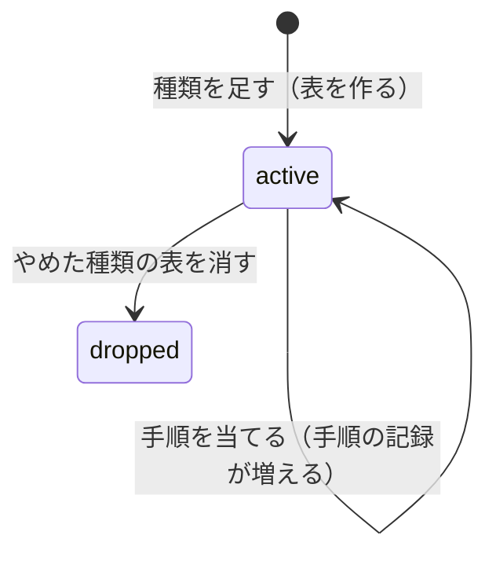

# ドメインモデル: 業務記録（features/records）

業務記録の今の仕様の正本です。変更の経緯は [records-plan.md](../plans/records-plan.md)、保存データは [data-inventory.md](../data-inventory.md) の業務記録の節（定義から生成）、ロールとログインは [auth.md](auth.md)、MCPの共通の決まりは [mcp.md](mcp.md) にあります。不変条件の番号（`RECORDS-INV-n`）の扱いは `docs/domain/auth.md` と同じです。

この機能は、ほかの機能と違い、扱う項目がコードに固定されていません。アプリの開発者（保守・カスタマイズする会社・個人）が Go のコードで書いた**定義**を読んで、表・画面・MCPのツールを組み立てます。定義は実行ファイルに組み込まれ、ログインした利用者は項目を変えられません。

## 1. 用語

| 用語 | 英語名 | 意味 |
|---|---|---|
| 業務記録 | — | この機能。日報、備品の台帳のような記録の総称 |
| 種類 | `RecordDef` | 記録の1つの型（例: 日報）。名前、表示名、目的、保持、権限の型、MCPに出すか、手順、項目の見せ方を持つ。種類ごとに表が1つある |
| 定義の一覧 | `Defs` | 有効な種類の一覧。ここに無い種類は画面にもMCPにも出ない |
| 項目 | `RecordField` | 種類の1つの欄（例: 日付）の見せ方。名前、表示名、必須、上限、選択肢を持つ。論理の型は手順から決まる。列 `f_<名前>` に保存する |
| 論理の型 | `FieldType` | `Text`・`LongText`・`Integer`・`Date`・`Select`・`Bool`。DBの列の型より細かい |
| 記録 | — | 種類の表の1行 |
| 所有者 | `owner_account` | 記録を作ったアカウント |
| 権限の型 | `RecordAccess` | `OwnerOnly`・`OwnerWriteAdminRead`・`OwnerWriteAllRead`・`AllReadWrite` のどれか。種類ごとに1つ |
| 版の数 | `revision` | 記録を保存するたびに1増える数。同時の編集を見分ける |
| 手順 | `RecordStep` | 種類の項目の構造の変更の1つ。追加（`Add`）、改名（`Rename`）、削除（`Remove`）、型の変換（`ChangeType`）のどれか。1から1ずつ増える番号を持ち、定義に積んでいく。消さず、書き換えない |
| 壊す手順 | — | 改名・削除・型の変換。前の版の実行ファイルでは扱えない変更 |
| 種類の番号 | `version` | 種類の最後の手順の番号 |
| 手順の文字列 | `step` | 1つの手順の中身を、決まった形で並べた文字列（例: `rename:customer:client`）。同じ番号の手順が同じ中身かを比べ、前の版が知らない追加の項目名と型を読むのに使う。形は8節で固定し、変えない |
| やめた種類 | `RetiredDefs` | 画面とMCPから外した種類の一覧。表を消した印も持つ。消さない |
| 種類の記録 | `records_tables` | DBの中の、種類ごとの状態（`active`・`dropped`）の記録 |
| 手順の記録 | `records_steps` | DBの中の、その環境に当てた手順ごとの、番号と手順の文字列の記録。種類と番号の組で1行 |
| 定義の記録 | `records.lock.json` | 最後に生成した時の定義の写し（種類ごとの手順の文字列の一覧、やめた種類）。コマンドが書き、人は直さず、コミットする。開発の時に、前の定義との差を調べるのに使う |
| 業務記録の節 | — | `data-inventory.md` の中で、定義から生成する範囲。印で囲む。書き出すだけで、読み返さない |
| 確認のコマンド | `runRecordsCheck` | コマンド `records-check`。デプロイの前に、本番のDBを読むだけで、この実行ファイルが起動したら何をするかを示す |
| 削除済みの所有者の記録 | — | 所有者のアカウントが削除済み（アカウントの一覧に無い）の記録 |

## 2. 概念と関係

```
定義の一覧 1 ─ n 種類 1 ─ n 手順（番号の順） ── 当てると → 列と論理の型
                  1 ─ n 項目の見せ方
                  1 ─ 1 表 1 ─ n 記録
DBの中: 種類の記録（状態） 1 ─ n 手順の記録（番号・手順の文字列）
リポジトリの中: 定義の記録（最後にレビューを通った手順の文字列の一覧）
```

- 種類の名前と項目名は、英小文字で始まり、英小文字・数字・`_` の30字以内。表名 `records_<種類>`、列名 `f_<項目>` に使う。種類の名前 `tables`・`steps` は使えない（記録の表とぶつかるため）。一度使った名前（改名の前の名前、消した項目、やめた種類を含む）は、同じ種類の中で使い回さない。
- 共通の列は `id`・`owner_account`・`revision`・`created_at`・`updated_at`。項目の列は全部 NULL 可で、必須は保存の時に検査する。
- アカウントIDは認証の表と外部キーでつながない。`features.AccountDirectory` で呼び名と状態を読み、一覧に無いIDは「削除済みのアカウント」、`Disabled` は「停止中」と出す。アカウントの一覧が無い構成では起動を止める。
- 項目の構造（どの列があり、論理の型は何か）は、手順を1から順に当てた結果で決まり、定義の中の正本は手順だけ。項目の見せ方（表示名・必須・上限・選択肢）は、手順を当てた結果の項目と名前で一致させる。
- **定義の手順**は「あるべき姿に至る道」、**手順の記録**は「その環境が今どこまで来たか」、**定義の記録**は「最後にレビューを通った道」。起動の時は、定義の手順・手順の記録・実際のDBの列の3つを比べる。開発の時は、定義の手順と定義の記録を比べる。Markdown は入力にしない。
- 前の版の実行ファイルは、自分の知らない番号の手順の文字列を読み、全部が追加なら、その項目名と型の列があることを確かめたうえで、使わずに残して動く。壊す手順や読めない手順が1つでもあれば止まる。だから、足しただけの更新は実行ファイルだけで戻せ、壊す手順を当てた更新は前の版で必ず止まる。

## 3. 状態の移り変わり

記録には状態の遷移は無い。承認や「貸出中」のような状態が要るなら、`Select` の項目として人が書き換える。

種類の記録の状態は、次のように移る。



`dropped` から `active` へは戻らない。

## 4. 項目の型と入力

| 型 | 列の型 | 入力欄 | 保存の時の検査 |
|---|---|---|---|
| `Text` | TEXT | 1行 | 文字数の上限 `MaxLen`（既定200）。改行とタブを拒否 |
| `LongText` | TEXT | 複数行 | 文字数の上限 `MaxLen`（既定4000）。表示は改行を保つ平文。記法は無し |
| `Integer` | INTEGER | 数値 | 64ビットの整数。範囲 `Min`・`Max` |
| `Date` | TEXT（`YYYY-MM-DD`） | 日付 | 実在の日付。時刻は持たない |
| `Select` | TEXT | 選択 | 定義の選択肢のどれか |
| `Bool` | INTEGER（0/1） | チェック欄 | — |

- 空の入力は NULL で保存する。必須の項目は空を拒否する。
- 定義を変えて合わなくなった既存の値（上限を超える、選択肢に無い、必須なのに空）は、そのまま表示し、次の保存で直させる。

## 5. 一覧と画面

- 画面は `docs/components.md` の画面の型で作る。種類の一覧、記録の一覧、作成、詳細、編集、削除の確認、削除済みの所有者の記録の一覧と、その削除の確認。
- 絞り込みは、`Text`・`LongText` の語（部分一致。`%`・`_`・`\` は文字として扱う）、`Select` の値、`Date` の期間、「自分の記録だけ」（`OwnerWriteAllRead`・`AllReadWrite`）。
- 並びは、定義の `ListFields` の項目と更新日時から選ぶ。同じ値の中は `id` の新しい順。知らない指定は既定の並びにする。
- ページ送りは「次へ」だけで、全件数は数えない（カタログと同じ）。
- 読めない記録、存在しない種類・記録は、同じ404にする。
- JS は使わない。

## 6. 不変条件

| 番号 | 条件 | 守る場所 |
|---|---|---|
| RECORDS-INV-1 | 全ての画面にログインが要る。停止中のアカウントは使えない。アカウントの一覧が無い構成では起動を止める | `requireRecordsDirectory`・`recordsRoutes` |
| RECORDS-INV-2 | 定義の検査に通らなければ、起動を止める。検査は、名前の規則と予約、種類の名前と項目の見せ方の名前の重複、使い回し、目的と保持が空でない、型と権限の型が決まった値、手順の番号が1から1ずつ増える、各手順が操作をちょうど1つ持つ、各手順の前提が手順を順に当てた時点で成り立つ（追加の名前が無い、改名の元があり先が無い、削除の項目がある、変換の前の型が今の型と同じ）、許されない型の変換、項目の見せ方が手順を当てた結果の項目と過不足なく1対1で一致する、上限・選択肢・範囲が型に合う、`ListFields`・`SortBy` が実在の項目を指す、やめた種類と定義の一覧の名前の重複 | `validateRecordDefs` |
| RECORDS-INV-3 | 読めない記録は、一覧、絞り込み、詳細、MCPのどこにも出ず、存在しない種類・記録と同じ404になる | `readableCondition`・`checkRecordAccess` |
| RECORDS-INV-4 | 作成・編集・削除は、権限の型の表（7節）のとおりにだけできる。ロールと状態は要求ごとに読む | `checkRecordAccess` |
| RECORDS-INV-5 | 1件の保存と削除は、開いた時の版の数が今と同じ時だけ行い、照合と書き込みの間に他の書き込みが入らない。違えば何も変えない。画面とMCPで同じ | `updateRecordRevision`・`deleteRecordRevision` |
| RECORDS-INV-6 | 必須・型・上限・選択肢は保存の時に検査する。定義が変わって合わなくなった既存の値は、そのまま表示し、次の保存で直させる | `validateFieldValue` |
| RECORDS-INV-7 | SQLの表名と列名は、検査済みの定義からだけ作り、引用符で囲む。読み書き・移行・コマンドの文は全部、定義から組み立てた文の集合から選ぶだけで、要求の値で文の文字列は変わらない。値は全部プレースホルダで渡す | `buildRecordStatements`・`recordsStatement` |
| RECORDS-INV-8 | 起動の時、手順の記録が定義の手順より短い種類は、足りない手順を番号の順に1つずつ当てる。全部の種類の手順と、手順の記録・種類の記録の書き込みを、1つのトランザクションで行い、途中で失敗したら何も変えずに起動を止める。既にあった表に壊す手順を1つでも当てる起動では、その前に1つの複製を作り、複製に失敗したら当てずに止める。その起動で作った表への手順と、追加だけの起動では複製を作らない。2回起動しても何も変わらない | `planRecordsMigration`・`applyRecordsMigration` |
| RECORDS-INV-9 | 定義の記録と台帳の節は定義から生成する。定義の記録の手順の文字列の一覧が、今の定義の手順の先頭と一致しない、または今の手順より長い（適用済みの手順の変更・削除）、やめた種類が消えた、定義の記録にある種類が定義の一覧からもやめた種類からも消えた、のどれかなら、生成を止める。定義の記録・台帳の節が今の定義から作ったものと違えば、テストが落ちる | `checkRecordsHistory`・`renderRecordsInventory` |
| RECORDS-INV-10 | アカウントの停止・削除で記録は消えない。削除済みの所有者の記録は、システム管理者が、種類と所有者ごとの件数だけを見て、確認の画面を経てまとめて消せる。対象は `AllReadWrite` 以外の種類で、確認の画面で選んだ種類と所有者だけ。実行の時にアカウントの一覧を読み直し、削除済みであることを確かめる。本文は見せない。アカウントの一覧の取得に失敗したら止める。停止中の所有者の記録はまとめて消せない | `purgeDeletedOwnerRecords`・`deletedOwnerCounts` |
| RECORDS-INV-11 | MCPの権限は接続したアカウント本人のもの。削除はできない。確認の文は `MCPSummary` で組み立て、値は `MCPQuote` で全文を引用する（4,000字の上限は MCP-INV-9 の共通の決まり） | `recordsMCPTools`・`recordsSummary` |
| RECORDS-INV-12 | やめた種類と、今の定義に無い列の値は、画面とMCPに出さない | `visibleRecordFields` |
| RECORDS-INV-13 | 記録の値、絞り込みの語、変換できない行の値は、ログと確認のコマンドの出力に出さない。確認のコマンドは種類・項目・行のIDだけを出す | `recordsCheckReport`・`logRecordsMigration` |
| RECORDS-INV-14 | 確認のコマンドは、DBを読むだけの接続で開き、表と行を変えない | `runRecordsCheck` |
| RECORDS-INV-15 | 起動の時は、まず種類を分ける。定義の一覧にある種類、やめた種類、どちらにも無い種類（新しい版が足した種類）。どちらにも無い種類は、その手順の記録の中身（改名等を含む）を問わず、表と記録を使わずに残して警告し、起動を続ける。定義の一覧にある種類について、次の時は起動を止め、DBを戻すか正しい版で起動するよう案内する。同じ番号の手順の文字列が定義と違う（分岐した定義）。定義に無い番号の、追加でない手順か、読めない手順がある（前の版の実行ファイル）。種類の記録が `dropped`。定義に無い番号の手順が全部追加の時は、その列を使わずに残して警告し、起動を続ける | `checkRecordsVersion` |
| RECORDS-INV-16 | 種類の記録が `active` の種類について、手順の記録の全部の手順（定義に無い番号の追加を含む）を当てた結果の列と、実際のDBの列が、名前と宣言の型で過不足なく一致しない時は、自動で直さずに起動を止める。手順の記録の番号が1から1ずつ増えていない、種類の記録が `active` なのに表が無い、`records_` の表に種類の記録が無い時も止める。種類の記録が `dropped` で表が無い種類は、列を照合しない。記録の表 `records_tables`・`records_steps` と作業用の `tmp_` の列は対象外 | `reconcileRecordsSchema` |
| RECORDS-INV-17 | 型の変換は、全部の行の値が新しい型の形（実在の日付 `YYYY-MM-DD`、整数（符号は `-` だけ、先頭に余分な `0` や空白が無い十進）で64ビットの範囲、0か1、改行とタブの無い1行）に合う時だけ行い、列の宣言の型も新しい型に合わせる。上限・選択肢・必須は変換では見ない。変換できない値を空にしない。NULL と空の文字列は NULL にする | `convertRecordColumn` |
| RECORDS-INV-18 | 記録の作成と保存は、今の定義が知っている列だけを名前で書き、行を置き換えない。前の版で保存しても、新しい版が足した列の値は残る | `insertRecord`・`updateRecordRevision` |

## 7. 権限

「全員」は、停止中でない全ロール（システム管理者、サイト管理者、一般ユーザー）。サイト管理者は、業務記録では一般ユーザーと同じ扱い。記録の画面は `AccountPage`・`AccountForm` で、削除済みの所有者の記録の画面は `AdminPage`・`AdminForm` で守る。

| 権限の型 | 作る | 読む | 編集 | 削除 |
|---|---|---|---|---|
| `OwnerOnly` | 全員 | 本人 | 本人 | 本人 |
| `OwnerWriteAdminRead` | 全員 | 本人、システム管理者 | 本人 | 本人、システム管理者 |
| `OwnerWriteAllRead` | 全員 | 全員 | 本人 | 本人、システム管理者 |
| `AllReadWrite` | 全員 | 全員 | 全員 | 全員 |

- 所有者が停止中・削除済みの記録は、読める人からは読める。編集は `AllReadWrite` なら全員、それ以外は誰もできない。
- 削除済みの所有者の記録のまとめての削除は、システム管理者だけができる（RECORDS-INV-10）。`AllReadWrite` は全員の共有の台帳で、作った人が辞めても記録は要るので、対象にしない。
- 上長・部署による権限は無い。

## 8. 定義の変更と移行

項目の構造を変えるには、定義に手順を積み、`make records-inventory` で定義の記録と台帳の節を作り直し、ビルドとデプロイをする。

```go
Steps: []records.RecordStep{
	{Version: 1, Add: &records.Add{Field: "work_date", Type: records.Date}},
	{Version: 2, Add: &records.Add{Field: "body", Type: records.LongText}},
	{Version: 3, Add: &records.Add{Field: "customer", Type: records.Text}},
	{Version: 4, Rename: &records.Rename{From: "customer", To: "client"}},
	{Version: 5, ChangeType: &records.ChangeType{Field: "work_date", From: records.Date, To: records.Text}},
},
Fields: []records.RecordField{ // 見せ方だけ。名前は手順を当てた結果と一致させる
	{Name: "work_date", Label: "日付", Required: true},
	{Name: "body", Label: "内容", Required: true, MaxLen: 4000},
	{Name: "client", Label: "訪問先"},
},
```

| 定義の変更 | 定義に書くこと | 起動の時 | 複製 |
|---|---|---|---|
| 種類を足す | 定義の一覧に足し、`Add` の手順を積む | 表を作り、手順の記録を書く | 無し |
| 項目を足す | `Add` の手順と、項目の見せ方 | 列を足す | 無し |
| 表示名・選択肢・上限・必須を変える | 項目の見せ方を直す | DBは変えない | 無し |
| 項目の名前を変える | `Rename` の手順と、見せ方の名前 | 列の名前を変える | 取る |
| 項目を消す | `Remove` の手順と、見せ方から消す | 列を消す | 取る |
| 論理の型を変える | `ChangeType` の手順 | 列を変換する | 取る |
| 種類をやめる | 定義の一覧から `RetiredDefs` へ移す | 表を残し、画面とMCPから外す | 無し |
| やめた種類の表を消す | デプロイの後に `records-drop` を実行し、`RetiredDefs` に消した印を付ける | — | 取る |

**手順の文字列の形**

手順の文字列は、次の形で固定する。区切りは `:`（名前と型に `:` は入らない）。後から形を変えると、全部の環境で正しい更新まで止まるため、変えない。型は `text`・`long_text`・`integer`・`date`・`select`・`bool` と書く。

| 手順 | 文字列 |
|---|---|
| 追加 | `add:<項目名>:<型>` |
| 改名 | `rename:<前の名前>:<後の名前>` |
| 削除 | `remove:<項目名>` |
| 型の変換 | `change_type:<項目名>:<前の型>:<後の型>` |

**手順の当て方**

- 新しいDBでも、手順を1から順に当てて表を作る（新しいDBと古いDBで、同じ道を通る）。
- 既にある種類は、手順の記録の続きから、定義の手順を番号の順に1つずつ当てる。版を飛ばした環境でも、追加を含む全部の手順が定義に残っているので、1段ずつ進む。
- 手順は消さず、書き換えない。どの環境がどこまで当てたかは、開発の側からは分からないため。まだどの環境でも起動していない手順を直したい時だけ、定義の記録をデプロイ済みの版（`main`）のものに戻してから作り直してよい。一度でも起動した環境は、実行ファイルを戻した後も手順の記録が残るので、その手順は書き換えず、後ろに手順を積んで直す。

**型の変換**

1つの手順で行える変換は次のとおり。版を飛ばした時も、手順ごとに変換するので、各段はこの表の中に収まる。

| 区分 | 変換 |
|---|---|
| 値の形を検査せずに変換できる | `Text`→`LongText`・`Select`、`Select`→`Text`・`LongText`、`Date`→`Text`・`LongText`、`Integer`→`Text`・`LongText`、`Bool`→`Integer` |
| 全部の行の形を検査してから変換する | `Text`・`LongText`・`Select`→`Date`・`Integer`、`LongText`→`Text`・`Select`、`Integer`→`Bool` |
| 許さない | 上の表に無い組み合わせ |

- 変換は、作業用の列（`tmp_` で始まる名前）を作って値を写し、古い列を消し、作業用の列の名前を戻す。列の宣言の型も新しい型に合わせる。
- 読み取りが要る変換は、デプロイの前に確認のコマンドで、変換できない行を出し、今の版の画面で直す。
- `Select` へ変換した後の、選択肢に無い既存の値は、編集の画面に今の値として示し、選び直すまで保存できない。

**やめた種類と表の削除**

`RetiredDefs` は、やめた種類の名前と、表を消した印だけを持つ。やめた種類の手順の文字列は、定義の記録が前の記録から写して持ち続ける。

| DBの状態 | 起動の時 | `records-drop` |
|---|---|---|
| 表と種類の記録（`active`）があり、消した印が無い | 表を残し、画面とMCPに出さない | 複製を作り、表を消し、種類の記録を `dropped` にする（1つのトランザクション）。複製のファイル名を出す |
| 表があり、消した印がある（表を消す前の複製を戻した等。種類の記録の状態は問わない） | 警告し、`records-drop` の再実行を案内する | 上と同じ |
| 種類の記録が `dropped` で、表が無い | 何もしない | 何もしない |
| 種類の記録も表も無い（やめた後に作った新しいDB） | 何もしない（記録も作らない） | 何もしない |

- `records-drop` の対象は `RetiredDefs` にある種類だけ。
- 新しいDBにやめた種類の記録を作らないので、その種類を使う前の版の実行ファイルは、空の表を作って動く。そのDBにはその種類のデータが一度も無かったので、害は無い。
- やめた種類を定義の一覧に戻すことはできない。

**前の版へ戻すとき**

| この更新でしたこと | 戻し方 |
|---|---|
| 種類・項目を足しただけ（見せ方の変更、種類をやめた、その起動で作った表への手順、を含む） | 実行ファイルだけ戻せばよい。前の版は、知らない番号の追加の列と、知らない表を警告だけで残す。前の版で保存した行でも、その列の値は残る（RECORDS-INV-18）。前の版で作った行のその列は空で、新しい版に戻した後、必須なら次の保存で入力を求める |
| 既にあった表に壊す手順を当てた（改名・削除・型の変換） | 起動の時に作った移行の前の複製から、DBも戻す。DBを戻さずに前の版を起動すると止まる（RECORDS-INV-15） |
| `records-drop` で表を消した | `records-drop` が作った複製から、DBも戻す |

- どれに当たるかは、デプロイの前に確認のコマンドが1行で示す。DBも戻す必要がある時は、複製のファイル名をリリースの記録に残す（`docs/deploy.md` の9節）。
- 戻し方は片道で、逆向きの手順は無い。複製を戻すと、複製の後に書いた記録は失う。
- 移行の前の複製（`pre-migration-records-*.db`）は自動では消えない。運用者が、戻す必要が無くなった後に消す。日々のバックアップは、その保持の期間で消える。どちらにも、消した列や表の値が残る。DBの中では `secure_delete` で上書きされる。

**見本の定義を使わないアプリ**

キットは見本の定義（日報・備品）と、その定義の記録を同梱する。見本を使わないアプリでは、どの環境にもまだデプロイしていない間だけ、見本を定義の一覧から消し、定義の記録を作り直してよい（`make records-inventory RESET=1`）。一度でもデプロイした後は、`RetiredDefs` に移す。

## 9. MCP

`/admin/mcp` で業務記録を有効にすると、`MCP: true` の種類がまとめて使えるようになる（有効にする単位は機能）。有効にする確認の画面には、使えるようになる種類の名前を並べ、記録の内容が接続した人の使うAIのサービスへ送られることを出す。全ロールが使える。

| 読み取り | 書き込み（確認あり） | MCPではできない |
|---|---|---|
| 一覧（画面と同じ絞り込み）、1件 | 作成、編集 | 削除、削除済みの所有者の記録の削除 |

確認の文は、最初の3行に操作・対象（「日報 #12（作った人: 呼び名）」）・変わる項目の名前を置き、編集では変わる項目の値だけを全文で引用する。確認の後に記録が変わっていたら（版の数が違えば）実行しない。長い項目（日報の内容など）は、確認の文が上限を超えるとMCPから書けず、管理画面で操作する。

## 10. 守らない範囲

- 利用者が画面で項目や種類を作ること。
- 承認、状態の遷移、通知。
- 部署・上長による権限。
- 種類をまたぐ参照と更新（例: 貸出の記録が備品を指す）、集計。
- 添付、画像、時刻つきの日時、行の履歴、移管、一括の取り込みと書き出し。
- 値の重複を防ぐこと（例: 備品の管理番号の一意）。項目の索引。
- `AllReadWrite` で、誰が最後に直したかを残すこと。
- `Text`・`LongText` に書かれる個人に結びつく内容を、型で防ぐこと。目的（`Purpose`）に書き、運用で守る。
- 定義の記録を手で書き換えた後の、開発の時の検査。起動の時の検査（RECORDS-INV-15・16）は効く。
- 型の変換での、選択肢の値の付け替え（例: 「済」を「完了」に）。
- 手でDBの表や列を変えた後の自動の修復。起動を止めるだけ（RECORDS-INV-16）。
- 逆向きの移行と、やめた種類を戻すこと。
- 「システム管理者にも見せない」（`OwnerOnly`）は画面の範囲の守りである。DB、バックアップ、サーバーを直接読める人の閲覧は止められない。
