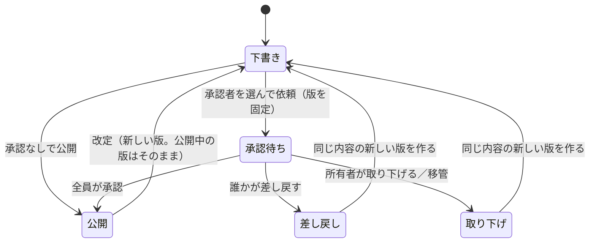

# 社内文書機能の計画

状態: 実装済み（2026-10-31）。完成のレビューの前。今の仕様は `docs/domain/documents.md` と `docs/domain/auth.md`。対象の時点は `9404ed4`。実装の後、今の仕様は `docs/domain/documents.md` と `docs/domain/auth.md` へ移す。

## 目的

組織の中で、回覧や社内規定などの文書を作り、全員または特定の人へ共有する。ログインしていない人は読めない。作った人だけが編集し、他の人は読むだけとする。作成者は、誰が読んだかを確かめられ、必要な文書には特定の人の承認を受けられる。

## 確定した判断（利用者の承認済み）

- ロールは3つ。画面の名前を次のとおりにする。

| 画面の名前 | 保存する値 | 文書 | 公開サイトの編集 | アカウント管理 |
|---|---|---|---|---|
| 一般ユーザー | `user`（新規） | 作成、共有、閲覧 | 不可 | 不可 |
| サイト管理者 | `member`（既存の「メンバー」） | 同じ | 可 | 不可 |
| システム管理者 | `admin`（既存の「管理者」） | 同じ | 可 | 可 |

- 編集できるのは所有者だけ。共有された人は読むだけ。
- 共有されていない文書は、システム管理者にも画面で見せない。
- 既読は開いたときに自動で記録し、版ごとに取り直す。作成者は共有先の既読を確かめられる。
- 承認は任意。承認を受ける文書では、所有者が特定のアカウントを1人以上選ぶ。所有者本人は選べない。選んだ全員の承認が要り、順番は無い。
- 承認者は、共有の設定にかかわらず、依頼された版を読める。差し戻しは理由を1行書く。
- 依頼中は本文を変えられない。承認は版に結びつき、改定したら承認を受け直す。古い版と承認の記録は残す。
- 所有者が退職したら、システム管理者が中身を見ずに所有者を移せる。
- 承認は社内の確認の記録で、法的な電子署名や改ざんの証明ではない。
- フォルダは整理のためだけに使い、権限を持たせない。
- 作らないもの: 添付、同時編集、グループ、外部への共有リンク。MCPは初版で対応しない。
- 境界2（下の保存データ）は承認済み。go.mod、外部通信、CSS・JSファイルの追加は無い。

## この計画で決めた細部

レビューで異論が無ければ、この形で進める。

| 項目 | 決定 | 理由 |
|---|---|---|
| 機能名 | `features/documents`、`make add-documents`、経路は `/admin/documents` | 管理者セッションのCookieの `Path` が `/admin` で、他の経路では読めない。`docs` はリポジトリの文書の置き場と紛らわしい |
| 共有先への出し方 | 共有先に見えるのは、公開した最新の版だけ。下書きは見えない | 書きかけを読ませない。既読と承認の版を固定する |
| 承認を受ける文書 | 全員の承認で、その版が自動で公開される | 承認の前の内容を共有先へ出さない。承認の後の別操作を要らなくする |
| 承認を受けない文書 | 所有者の操作で公開する | 承認を任意にする |
| 版の固定 | 依頼した時点で版を固定する。差し戻しと取り下げでは、その版から新しい下書きを作る | 差し戻しの記録が指す内容を変えない。承認者が書き直し中の下書きを読めないようにする |
| 古い版 | 所有者だけが読める。共有先には今の版と、その版の承認の記録を見せる | 共有先に廃止された規定を読ませない |
| フォルダ | 全アカウントで共通、1階層。名前は全員に見える。誰でも作れて、変更と削除は作った人かシステム管理者。文書が1件でも入っていれば削除できない | 共通の棚として使う。名前が見えることは作成画面で知らせる。階層は必要になってから足す |
| 検索 | 読める文書の今の版のタイトルと本文を `LIKE` で探す。自分の下書きも含む | 依存を増やさない。件数は小さな組織を想定する |
| 文書の削除 | 所有者が確認画面を経て削除する。版、共有、既読、承認の記録も消える | 保持の方針は組織が運用で決める |
| 移管の対象 | 所有者が停止中か削除済みの文書だけ。所有者ごとの一括で移す。画面には件数だけを出し、タイトルも見せない。移す先に操作者本人は選べない | タイトルも中身の一部になりうる。有効なアカウントの文書を奪えないようにする。自分へ移せば読めてしまう |
| 移管時の依頼 | 承認待ちの版は取り下げて下書きへ戻す | 新しい所有者が承認者に含まれると、本人が承認できてしまう |
| アカウントの削除 | 文書は残し、削除済みとして表示する。共有・承認・既読の行はIDのまま残す | 認証の表と機能の表をつながない。削除の前に移管を強制しない |
| アカウントの情報 | `AccountDirectory` の口を足す。呼び名と状態（有効、停止中、不在）を返す。呼び名の無い `federatedauth` は対象外で、文書機能との組み合わせは起動時に止める | 相手を選ぶには呼び名が要り、移管と既読の母数には状態が要る。認証の表は機能から直接読まない。`federated_accounts` に呼び名が無い |

呼び名の扱いが変わる。今は管理者だけが見ているアカウントの呼び名が、共有先と承認者を選ぶ画面で、ログイン中の全員に見える。`docs/data-inventory.md` と管理者認証の画面の説明を更新する。

## 守らない範囲（文書と画面に明記する）

「システム管理者にも見せない」は、画面の範囲の守りとする。次の操作は止められない。

- DB、バックアップ、サーバーを直接読める人の閲覧。
- 登録URLの再発行や鍵のリセットで対象のアカウントになりすます操作。
- 対象を停止して、別のアカウントへ移管し、その別のアカウントで読む操作。移管の記録は残るが、防げない。

暗号化は入れない。承認の記録はDBを書き換えられる人の変更を防げない。

## 権限の変更（最も影響が大きい）

今の `Admin.Page`・`Admin.Form` は、ログインしていれば誰でも通す。お知らせ、カタログ、固定ページ、MCPの設定などが、これを使っている。`user` を足すだけでは、一般ユーザーが公開サイトを編集できてしまう。

閉じる側を既定にする。

1. `Admin.Page`・`Admin.Form` は、`admin` と `member` だけを通す（許可の一覧で判定し、未知の値も403）。既存の機能と、キットから作ったアプリの機能は、変更なしで閉じる。
2. `Admin.AccountPage`・`Admin.AccountForm` を足す。ログインしていれば通す。文書機能だけが使う。
3. `features/auth` の内部の `page`・`form`（パスキーの管理、ログアウト）は全員に開いたままにする。アカウント管理は `adminOnly` のまま。
4. `web.NavLink` に `AllRoles` を足し、既定では一般ユーザーのナビに出さない。`adminNav` はロールを受け取る。`handleAdminHome` は今 `adminNav(false)[0]` で移動先を決めているので、実際のロールを使う。
5. MCP: `/admin/agent/continue`・`approve` は `Page`・`Form` なので一般ユーザーは同意できない。さらに `/mcp` の `handle` で、`VerifyBearer` の後に `admin`・`member` 以外を403にする。ロールを下げた場合に、発行済みのトークンを止めるため。応答はスコープ不足と分ける。接続の許可の一覧（`agentAccounts`）からも一般ユーザーを除く。
6. `roleLabel` を3つに分ける。今は `admin` 以外をすべて「メンバー」と表示する。`validRole` とロールの変更のフォームも3つにする。最後の管理者の守りは変えない。
7. `federatedauth` は `AccountPage`・`AccountForm` を実装し、`Page`・`Form` も同じ許可の一覧で閉じる。`user` のロールは足さない（CHECK も変えない）。
8. `oidcop` はロールを連携先へ渡していない。連携先の利用は、ロールとは別の利用許可で管理者が決めるので、`/admin/oidc/continue`・`approve` は `AccountPage`・`AccountForm` にする。一般ユーザーも、許可された連携先へログインできる。

テスト: `test/admin_ui_test.go` の見本のすべての経路を一般ユーザーで開き、許可の一覧にある経路だけが通ることを確かめる。経路を足すと、この表に足さない限り落ちるようにする。

## 表示名の変更

画面、README、`docs/`（`plans/` を除く）、コメントで、ロールの「管理者」「メンバー」を「システム管理者」「サイト管理者」に直す。機能名の「管理者認証」、語の「管理画面」は残す。`admin`・`member`・`IsAdmin` などのコードの名前と保存する値は変えない。ログイン画面の「管理画面へのログイン」は、一般ユーザーも使うので「ログイン」にする。

## DBの移行（レビューの重点）

`auth_accounts.role` に `CHECK (role IN ('admin', 'member'))` があり、値を足すには表を作り直す必要がある。別の列や別の表で表すと、権限の正本が2つになるので採らない。

`auth_credentials` などが `ON DELETE CASCADE` で参照している。`features/contact/migrate.go` の手順を写すと、`foreign_keys` が有効なまま `DROP TABLE` が行を消し、**パスキーとセッションが全部消える**。SQLiteの公式の手順に従う。

1. 判定: `sqlite_master.sql` にCHECKの列挙 `'admin', 'member', 'user'` が無ければ移行する（`webauthn_user_id` の `user` に当たらないよう、引用符を含めて照合する）。作業用の表が残っていたら起動を止める。
2. `store.BackupBeforeMigration` で複製を作る。失敗したら移行しない。
3. `db.Conn` で接続を1本に固定し、トランザクションの外で `PRAGMA foreign_keys=OFF` とする。値が0になったことを読み返す。
4. `BEGIN IMMEDIATE` で、`sqlite_sequence` の値を読み、`auth_accounts_new` の作成、行の写し、`DROP TABLE auth_accounts`、改名、`sqlite_sequence` を読んだ値以上に戻す、`migrationSQL` の再実行（トリガーの再作成）、`PRAGMA foreign_key_check` を行う。
5. コミットの後に `PRAGMA foreign_keys=ON` として読み返す。戻せなければ、`Conn.Raw` で `driver.ErrBadConn` を返して、その接続をプールへ返さない。

`auth_accounts` の表が持つトリガー6本は、表を落とすと一緒に消える。`AUTH-INV-17` の失効がこれに頼っているので、作り直さないと、停止しても連携先のログインとエージェントのトークンが止まらない。

新規のDBは `migration.sql` をそのまま流す。ID、呼び名、ロール、`webauthn_user_id`、パスキー、セッション、登録トークン、連携の識別子、エージェントのトークン、トリガー6本が残ること、最大のIDを削除した後に移行しても次のIDが再利用されないこと、旧形式では走り新形式では走らないこと、移行の後に停止するとトークンが失効することを、古い形式のファイルのDBから移行するテストで確かめる（共有キャッシュのメモリDBは使わない）。

`Migrate` は `auth-setup` などのコマンドからも呼ばれる。この条件は `AUTH-INV` の新しい番号でテストに結びつける。

**戻すときの注意**: 移行の後に古い版へ戻すと、古い版は `user` を止めないので、一般ユーザーが公開サイトを編集できる。古い版の画面では一般ユーザーのロールも変えられない。戻すときは、先に一般ユーザーを停止する。配布の変更点に書く。

文書機能を有効にしていないサイトでも、この移行は1度だけ走る。

## 保存データ

`features/documents/migration.sql`。アカウントIDは他の表と外部キーでつながない。

| 表 | 主な列 | 目的 | 保持 |
|---|---|---|---|
| `document_folders` | `id`, `name`, `created_by`, `created_at` | フォルダ | 削除まで |
| `documents` | `id`, `owner_account_id`, `folder_id`, `audience`（`private`・`everyone`・`selected`）, `current_version_id`, `created_at`, `updated_at` | 文書の本体 | 削除まで |
| `document_versions` | `id`, `document_id`, `number`, `title`, `body`, `state`（`draft`・`pending`・`rejected`・`withdrawn`・`published`）, `created_at`, `requested_at`, `published_at` | 版 | 文書の削除まで |
| `document_shares` | `document_id`, `account_id` | 指定の共有先 | 外すか文書の削除まで |
| `document_approvers` | `version_id`, `account_id`, `decision`, `reason`, `decided_at` | 承認者と判断 | 文書の削除まで |
| `document_reads` | `version_id`, `account_id`, `first_read_at` | 既読 | 文書の削除まで |
| `document_transfers` | `id`, `from_account_id`, `to_account_id`, `by_account_id`, `count`, `transferred_at` | 移管の記録 | 3年で `Purge` |

- 下書きと承認待ちは、合わせて文書ごとに最大1つ（`state IN ('draft', 'pending')` を条件にした一意の索引）。承認待ちの間は改定を始められず、承認を経ない公開もできない。
- `draft` の行だけ書き換えられる。それ以外の行のタイトルと本文は変えない。
- 既読の記録は従業員の行動の記録に当たる。`PrivacyNotices` と `docs/data-inventory.md` に載せる。`minimal-web-kit-privacy` で見直す。
- 本文とタイトルはログに出さない。カナリアのテストを足す。

## 状態

## 読める範囲

読む処理はすべて、閲覧者のアカウントIDを必ず受け取るストアの関数を通す。判定は文書単位ではなく版単位で行う。権限が無ければ、文書の有無も分からないように404を返す。一覧、検索、既読、版の履歴も同じ条件を使う。

| 対象 | 読める人 |
|---|---|
| 今の版 | 所有者、`everyone` なら全アカウント、`selected` なら共有先 |
| 下書き、古い版 | 所有者 |
| 依頼された版 | 上に加えて、承認待ちの間の承認者と、判断を記録した承認者 |
| 既読の一覧、共有先の一覧 | 所有者 |

システム管理者への例外は無い。

`GET /admin/documents/{id}` は今の版だけを描き、共有先でない承認者には404を返す。承認者は `/{id}/versions/{version}` で依頼された版を開く。共有先でない承認者に、公開中の別の版を見せないため。

## 既読

- 共有先が今の版を開くと、`INSERT OR IGNORE` で記録する。所有者、古い版を開く承認者は記録しない。
- GETで書き込む例外として、仕様に理由を書く。ボタンなしで既読にするという要件による。HEADと、`Sec-Purpose`・`Purpose` に `prefetch` を含む要求では記録しない。書き込みの失敗で本文の表示を止めない（ログに残す）。
- 表示する母数は、`everyone` なら有効な全アカウント、`selected` なら共有先。

## 承認の処理

- 依頼: 所有者の下書きに対して、有効なアカウントを1人以上選ぶ。本人は拒否する。
- 判断: 版のIDをフォームに持つ。`BEGIN IMMEDIATE` の取引で、版が `pending` であることを条件に、承認者本人の未判断の行だけ更新する。全員そろえば、`pending` を条件に `published` にして `current_version_id` を変える。
- 差し戻し: 1人でも差し戻すと `rejected` になり、残りの人は判断できない。所有者の操作で、同じ内容の下書きを作る。
- 取り下げ: 所有者が行う。承認者が停止されて進まないときは、取り下げて選び直す。
- 移管: `BEGIN IMMEDIATE` の取引で、所有者が有効でないことを読み直してから移す。承認待ちは取り下げて、同じ内容の下書きを作る。
- 古い画面からの送信は、状態の条件付きの更新で何も変えず、やり直しを促す。

## 画面

すべて `docs/components.md` の型に沿って作り、`adminSamples` に足す。JSは使わない。承認者と共有先は `<fieldset>` のチェックボックスで選ぶ。本文は `internal/web/richtext` で描く。

| 経路 | 画面 | 型 |
|---|---|---|
| `GET /admin/documents` | 読める文書の一覧（フォルダ、検索、未読の印） | 一覧 |
| `GET /admin/documents/mine` | 自分の文書の一覧 | 一覧 |
| `GET /admin/documents/approvals` | 承認の依頼の一覧 | 一覧 |
| `GET /admin/documents/new`、`POST /admin/documents` | 作成 | 作成 |
| `GET /admin/documents/{id}` | 今の版の閲覧（既読の記録） | 文書の閲覧（新しい型） |
| `GET /admin/documents/{id}/edit` | 下書きの編集 | 編集 |
| `GET /admin/documents/{id}/share` | 共有先の設定 | 編集 |
| `GET /admin/documents/{id}/approval` | 承認の依頼 | 作成 |
| `GET /admin/documents/{id}/reads` | 既読の状況 | 詳細 |
| `GET /admin/documents/{id}/versions`、`/{version}` | 版の履歴と版の閲覧（承認の判断のフォーム） | 一覧、文書の閲覧 |
| `GET /admin/documents/{id}/delete` | 削除の確認 | 削除の確認 |
| `GET /admin/document-folders` | フォルダ | 一覧＋追加 |
| `GET /admin/documents/transfer` | 所有者の変更（`AdminPage`） | 一覧＋追加 |

本文を読ませる画面は既存の「詳細」に合わないので、`docs/components.md` に「文書の閲覧」の型を足す。

変更はPOSTだけで行い、`AccountForm` で守る（移管だけ `AdminForm`）。

## ユースケース（`docs/ui/use-cases.md` に足す）

アクターに「一般ユーザー」を足す。「管理画面の利用者」の説明を、サイト管理者とシステム管理者に直す。

- 文書を作り、全員か特定の人へ共有する。
- 共有された文書を読む。
- 自分の文書を読んだ人を確かめる。
- 承認者を選び、承認を依頼する。
- 依頼された文書を読み、承認するか差し戻す。
- 文書を改定し、取り下げ、削除する。
- フォルダで整理する。
- 停止中の所有者の文書を別の人へ移す。

## 不変条件の案（`DOC-INV-n`）

1. 全画面にログインが要る。ログインしていない要求には文書の内容も有無も出さない。
2. 権限の無い文書は、一覧、検索、詳細、既読、版のどこにも出ず、404になる。システム管理者も同じ。
3. 編集、共有の変更、依頼、取り下げ、削除は所有者だけができる。
4. 共有先に見えるのは今の版だけ。下書きは見えない。
5. 下書き以外の版のタイトルと本文は変わらない。
6. 承認された版だけが、承認を受ける流れから公開される。選んだ全員の承認が無ければ公開されない。
7. 所有者は自分の依頼の承認者になれない。移管の後も同じ。
8. 既読は版ごとに1人1行で、最初の日時だけを残す。
9. 移管の対象は停止中か削除済みの所有者の文書だけで、画面に件数だけを出し、操作者本人へは移せず、記録を残す。
10. 文書のタイトル、本文、差し戻しの理由、検索語をログに出さない。
11. アカウントの停止と削除で、文書は消えない。
12. 変更はPOSTで行う。例外は開いたときの既読の記録だけ。

`auth.md` に足す条件: 一般ユーザーは公開サイトの編集とMCPを使えない。`Page`・`Form` は未知のロールを通さない。ロールの追加の移行で認証の行が失われない。

## 進め方

1. この計画のレビューを受ける（Coreの経路、DBの移行、守りに触れるため）。
2. ロールの追加を1つの変更として出す: 移行、`Page`・`Form`、`AccountPage`、ナビ、MCP、表示名、テスト。この時点では `user` は作れても文書機能は無い。
3. 文書の本体: 版、共有、フォルダ、検索。
4. 承認、既読、移管。
5. 仕様、台帳、ユースケース、README、トップのカード、`cmd/kit` の `bundles`、`make add-documents`。
6. 完成のレビュー、紹介サイトへの適用は別に決める。

## 実装で変えたこと

- 一度でも承認を依頼した文書は、承認を経ないと公開できないようにした。改定や差し戻しの後に、承認なしで公開できる抜け道があったため。
- 差し戻しと取り下げでは、所有者の操作を待たず、同じ内容の下書きを自動で作る。
- 検索は今の版だけを対象にした。自分の下書きは「自分の文書」の一覧で見る。
- 版の番号は、差し戻しや取り下げがあると飛ぶ。
- 文書の閲覧は「詳細」に入れず、`docs/components.md` の型の外とした。新しい型は足していない。
